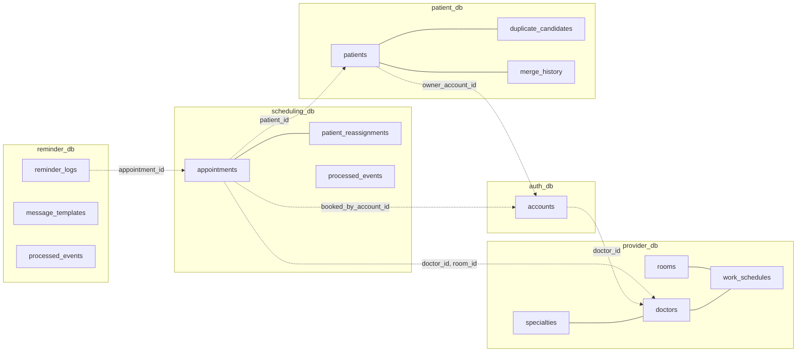
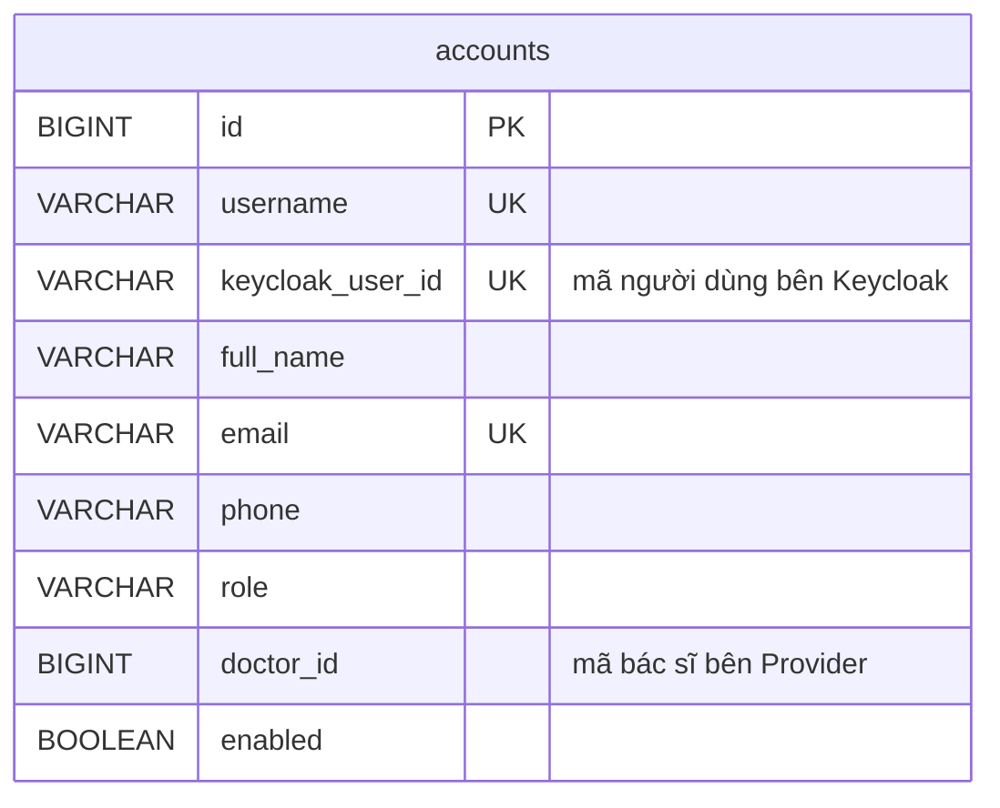
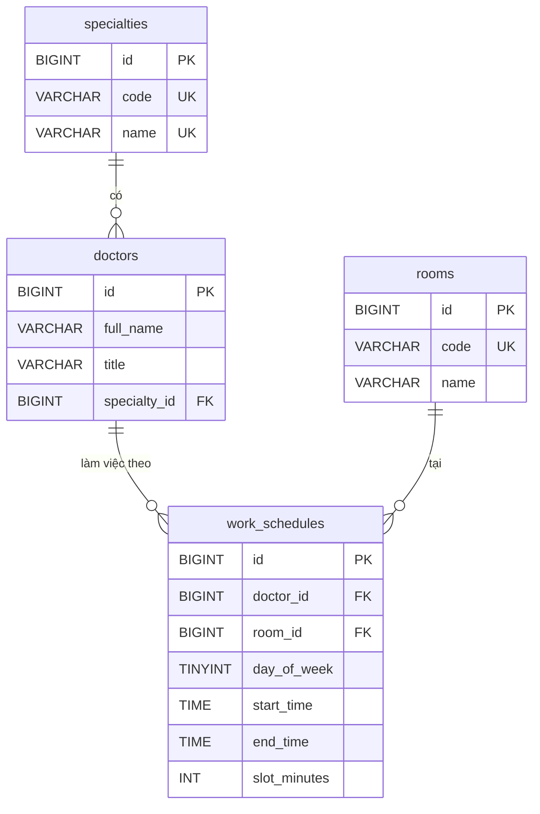
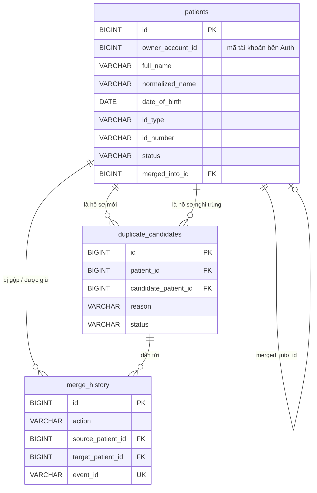
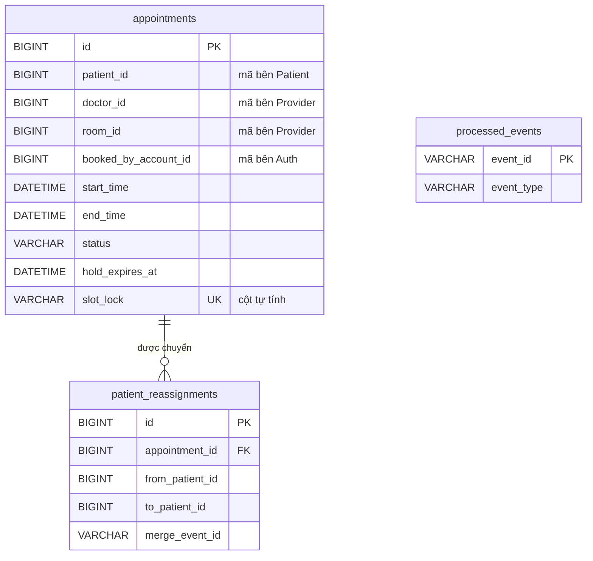

# 02. Cơ sở dữ liệu

Đọc file này khi cần biết bảng, cột của service mình, dữ liệu mẫu có gì, và kịch bản kiểm thử dùng số nào. Bảng đã tạo sẵn trong code: mỗi service có `src/main/resources/schema.sql` (tạo bảng), `data.sql` (dữ liệu mẫu) và các lớp entity Java ánh xạ đúng từng cột.

Bảng dữ liệu là một phần của hợp đồng giữa các phần việc; sửa cột theo mục 6.

## Tổng quan cơ sở dữ liệu theo phần việc

| Phần | Service | Database | Các bảng | Vai trò |
|---|---|---|---|---|
| — (đã làm sẵn) | Auth Service | [`auth_db`](#31-auth_db--auth-service) | `accounts` | Tài khoản đăng nhập, vai trò, liên kết tài khoản bác sĩ với bác sĩ bên Provider |
| P3 | Provider Service | [`provider_db`](#32-provider_db--provider-service) | `specialties`, `rooms`, `doctors`, `work_schedules` | Danh mục chuyên khoa, phòng, bác sĩ và ca làm việc — nguồn để Scheduling tính slot |
| P1 | Patient Service (MPI) | [`patient_db`](#33-patient_db--patient-service-mpi) | `patients`, `duplicate_candidates`, `merge_history` | Hồ sơ bệnh nhân, hàng chờ duyệt hồ sơ nghi trùng, lịch sử gộp / tách |
| P2 | Scheduling Service | [`scheduling_db`](#34-scheduling_db--scheduling-service) | `appointments`, `patient_reassignments`, `processed_events` | Lịch hẹn và chống đặt trùng slot, lịch hẹn đã chuyển khi gộp hồ sơ, sự kiện đã xử lý |
| P5 | Reminder Service | [`reminder_db`](#35-reminder_db--reminder-service) | `reminder_logs`, `message_templates`, `processed_events` | Nhật ký thông báo (nhắc, xác nhận, báo hủy), chống gửi lặp, mẫu thư, sự kiện lịch hẹn đã xử lý |

API Gateway không có database. Keycloak có `keycloak_db` riêng, chỉ Keycloak dùng.

---

## 1. Nguyên tắc chung

| Nguyên tắc | Làm thế nào trong hệ thống này |
|---|---|
| **Database per Service** (mỗi service sở hữu database riêng) | Một máy chủ MySQL chứa **5 database tách biệt**: `auth_db`, `provider_db`, `patient_db`, `scheduling_db`, `reminder_db`. Mỗi service đăng nhập MySQL bằng **tài khoản riêng**, tài khoản đó **chỉ có quyền trên database của mình** (tạo trong `docker/mysql/init/01-create-databases.sh`). Service A muốn đọc bảng của service B cũng không được — MySQL từ chối. |
| **Không khóa ngoại chéo service** | Khi một bảng cần nhắc tới thực thể của service khác (ví dụ lịch hẹn cần biết bệnh nhân nào), bảng chỉ lưu **mã** (`patient_id`) dưới dạng số thường. Muốn biết tên bệnh nhân thì **gọi API** của Patient Service. Khóa ngoại (`FOREIGN KEY`) chỉ dùng **bên trong** một database. |
| **Ràng buộc nghiệp vụ đặt ở database khi có thể** | Chống đặt trùng slot, chống trùng giấy tờ, chống gửi nhắc lặp đều được bảo đảm bằng ràng buộc `UNIQUE` — kể cả khi hai request tới cùng lúc (xem mục 4). |
| **Giờ Việt Nam, không múi giờ** | Cột ngày giờ dùng `DATETIME`, Java dùng `LocalDateTime`. Mọi container chạy múi giờ `Asia/Ho_Chi_Minh`. |
| **Enum lưu dạng chữ** | Cột trạng thái lưu `VARCHAR` + ràng buộc `CHECK`, Java ánh xạ bằng `@Enumerated(EnumType.STRING)`. Đọc database thấy ngay `CONFIRMED` thay vì số `1`. |

Một máy chủ MySQL chứa nhiều database tách tài khoản là cách "schema per service" của mẫu Database per Service, đỡ tốn RAM hơn 5 máy chủ. Muốn tách hẳn thì thêm container MySQL và đổi `DB_HOST` của service đó trong `docker-compose.yml`, không phải sửa code.

---

## 2. Tổng quan: ai giữ bảng nào, ai nhắc tới ai



- Đường **liền** (`---`): khóa ngoại thật, trong cùng một database.
- Đường **đứt** (`-.->`): chỉ lưu mã, không khóa ngoại; lấy dữ liệu bằng API.

---

## 3. Chi tiết từng database

Ký hiệu cột "Bắt buộc": ✔ = `NOT NULL`.

### 3.1. `auth_db` — Auth Service



**`accounts`** (tài khoản đăng nhập). Mật khẩu, phiên đăng nhập nằm ở Keycloak (`keycloak_db`); bảng này giữ mã số tài khoản và thông tin nghiệp vụ.

| Cột | Kiểu | Bắt buộc | Ý nghĩa |
|---|---|---|---|
| `id` | BIGINT | ✔ | Mã tài khoản; Keycloak lưu thành thuộc tính `accountId`, đưa vào claim `accountId` của token; Gateway gắn thành header `X-User-Id` |
| `username` | VARCHAR(50) | ✔ | Tên đăng nhập, duy nhất, chữ thường (Keycloak tự đổi về chữ thường) |
| `keycloak_user_id` | VARCHAR(36) | | Mã (UUID) người dùng bên Keycloak, duy nhất; dùng để khóa / mở tài khoản qua Admin API |
| `full_name` | VARCHAR(255) | ✔ | Họ tên hiển thị |
| `email` | VARCHAR(255) | | Duy nhất nếu có |
| `phone` | VARCHAR(20) | | |
| `role` | VARCHAR(20) | ✔ | `PATIENT`, `RECEPTIONIST`, `DOCTOR`, `ADMIN` |
| `doctor_id` | BIGINT | | Chỉ với `DOCTOR`: mã bác sĩ bên Provider Service → thuộc tính `doctorId` trong Keycloak, đưa vào token để bác sĩ xem đúng lịch của mình |
| `enabled` | BOOLEAN | ✔ | `false` = khóa tài khoản; khóa / mở thì Auth Service đổi cả người dùng bên Keycloak |
| `created_at`, `updated_at` | DATETIME | ✔ | Tự điền |

### 3.2. `provider_db` — Provider Service



**`specialties`** (chuyên khoa): `id`, `code` (mã ngắn, duy nhất, ví dụ `NOI`), `name` (duy nhất), `description`, `active`.

**`rooms`** (phòng khám): `id`, `code` (duy nhất, ví dụ `P101`), `name`, `location`, `active`.

**`doctors`** (bác sĩ)

| Cột | Kiểu | Bắt buộc | Ý nghĩa |
|---|---|---|---|
| `id` | BIGINT | ✔ | Mã bác sĩ — service khác lưu mã này dưới tên `doctor_id` |
| `full_name` | VARCHAR(255) | ✔ | |
| `title` | VARCHAR(50) | | Học hàm/học vị: `BS`, `ThS.BS`, `BS.CKI`… |
| `specialty_id` | BIGINT | ✔ | Khóa ngoại → `specialties`. Mỗi bác sĩ thuộc **một** chuyên khoa |
| `phone`, `email` | | | |
| `active` | BOOLEAN | ✔ | `false` = ngừng nhận lịch |

**`work_schedules`** (ca làm việc lặp lại hằng tuần)

| Cột | Kiểu | Bắt buộc | Ý nghĩa |
|---|---|---|---|
| `doctor_id` | BIGINT | ✔ | Khóa ngoại → `doctors` |
| `room_id` | BIGINT | ✔ | Khóa ngoại → `rooms`: ca này khám ở phòng nào |
| `day_of_week` | TINYINT | ✔ | 1 = Thứ Hai … 7 = Chủ nhật (theo chuẩn ISO, khớp `java.time.DayOfWeek.of(...)`) |
| `start_time`, `end_time` | TIME | ✔ | Ví dụ 07:30 – 11:30; ràng buộc `start_time < end_time` |
| `slot_minutes` | INT | ✔ | Thời lượng một lượt khám (5 – 120 phút). Ca 07:30–11:30 với 20 phút → 12 slot |
| `effective_from` | DATE | ✔ | Ngày bắt đầu áp dụng |
| `effective_to` | DATE | | Ngày hết áp dụng; `NULL` = chưa hết |
| `active` | BOOLEAN | ✔ | Xóa ca = đặt `false`, không xóa dòng |

> **Cách tính "ca của bác sĩ X ngày D":** lấy các dòng có `doctor_id = X`, `day_of_week = thứ của D`, `active = true`, `effective_from ≤ D` và (`effective_to` rỗng hoặc `≥ D`). Truy vấn này đã có sẵn: `WorkScheduleRepository.findEffective(...)`.

### 3.3. `patient_db` — Patient Service (MPI)



**`patients`** (hồ sơ bệnh nhân)

| Cột | Kiểu | Bắt buộc | Ý nghĩa |
|---|---|---|---|
| `id` | BIGINT | ✔ | Mã hồ sơ — Scheduling lưu mã này dưới tên `patient_id` |
| `owner_account_id` | BIGINT | | Tài khoản `PATIENT` quản lý hồ sơ (mã bên Auth). Một tài khoản quản lý được nhiều hồ sơ (bản thân + con). `NULL` nếu lễ tân tạo tại quầy |
| `created_by_account_id` | BIGINT | ✔ | Ai tạo hồ sơ (bệnh nhân hoặc lễ tân) |
| `full_name` | VARCHAR(255) | ✔ | Họ tên như người dùng nhập |
| `normalized_name` | VARCHAR(255) | ✔ | Họ tên **bỏ dấu, viết thường, gộp khoảng trắng** — "Lê  Thị Hoa" → `le thi hoa`. Dùng để so khớp; service phải tự tính khi lưu |
| `date_of_birth` | DATE | ✔ | |
| `gender` | VARCHAR(10) | ✔ | `MALE`, `FEMALE`, `OTHER` |
| `phone`, `email`, `address` | | | `email` là nơi Reminder gửi nhắc lịch |
| `id_type` | VARCHAR(10) | | `CCCD`, `PASSPORT`, `BHYT` — không bắt buộc |
| `id_number` | VARCHAR(20) | | Số giấy tờ |
| `guardian_name`, `guardian_phone`, `guardian_relation` | | | Người giám hộ (trẻ em, người cao tuổi được đặt hộ) |
| `status` | VARCHAR(10) | ✔ | `TEMPORARY` (tạm) → `ACTIVE` (đang dùng) → `MERGED` (đã gộp) |
| `merged_into_id` | BIGINT | | Khi `MERGED`: gộp vào hồ sơ nào (khóa ngoại tới chính bảng này) |
| `version` | BIGINT | ✔ | Khóa lạc quan (`@Version`): hai người cùng sửa, người lưu sau bị báo lỗi thay vì ghi đè |
| `active_identity` | VARCHAR(40) | | **Cột tự tính, không ánh xạ trong Java** — xem mục 4.1 |

**`duplicate_candidates`** (hàng chờ duyệt hồ sơ nghi trùng)

| Cột | Ý nghĩa |
|---|---|
| `patient_id` | Hồ sơ mới / hồ sơ tạm vừa phát sinh |
| `candidate_patient_id` | Hồ sơ có sẵn bị nghi là cùng người |
| `reason` | `SAME_ID_DIFFERENT_INFO` (tình huống 2: trùng giấy tờ nhưng lệch tên/ngày sinh), `SAME_NAME_DOB_PHONE` (tình huống 3: không giấy tờ, trùng tên + ngày sinh + SĐT), `ID_ADDED_BELONGS_TO_OTHER` (tình huống 5: bổ sung giấy tờ đã thuộc hồ sơ khác) |
| `score` | Điểm giống nhau **chỉ để lễ tân tham khảo** (tính bằng lớp `MatchScorer`, chuyển từ code MPI). Không bao giờ dùng để tự gộp |
| `status` | `PENDING` (chờ) → `MERGED` (đã gộp) hoặc `NOT_DUPLICATE` (lễ tân xác nhận không trùng) |
| `reviewed_by_account_id`, `reviewed_at`, `review_note` | Ai duyệt, lúc nào, ghi chú |

Cặp (`patient_id`, `candidate_patient_id`) là duy nhất → không đưa một cặp vào hàng chờ hai lần.

**`merge_history`** (lịch sử gộp / tách)

| Cột | Ý nghĩa |
|---|---|
| `action` | `MERGE` hoặc `UNMERGE` |
| `source_patient_id` | Hồ sơ bị gộp (B) |
| `target_patient_id` | Hồ sơ được giữ lại (A) |
| `source_previous_status` | Trạng thái của B **trước** khi gộp — để khi tách trả B về đúng trạng thái cũ |
| `duplicate_candidate_id` | Cặp trong hàng chờ đã dẫn tới lần gộp này |
| `related_merge_id` | Với `UNMERGE`: trỏ về dòng `MERGE` mà lần tách này hoàn tác |
| `event_id` | Mã sự kiện (UUID) đã phát qua RabbitMQ — duy nhất |
| `performed_by_account_id`, `performed_at`, `note` | Ai làm, lúc nào, ghi chú |

### 3.4. `scheduling_db` — Scheduling Service



**`appointments`** (lịch hẹn)

| Cột | Kiểu | Bắt buộc | Ý nghĩa |
|---|---|---|---|
| `patient_id` | BIGINT | ✔ | Mã hồ sơ bên Patient (không khóa ngoại) |
| `doctor_id` | BIGINT | ✔ | Mã bác sĩ bên Provider (không khóa ngoại) |
| `room_id`, `work_schedule_id` | BIGINT | | Chép từ ca làm việc lúc giữ chỗ, để không phải hỏi lại Provider |
| `booked_by_account_id` | BIGINT | ✔ | Tài khoản đã đặt (bên Auth) — "lịch của tôi" lọc theo cột này |
| `start_time`, `end_time` | DATETIME | ✔ | Giờ bắt đầu / kết thúc slot |
| `status` | VARCHAR(12) | ✔ | `HELD` → `CONFIRMED` → `COMPLETED`; `CONFIRMED` → `NO_SHOW` (không đến, CS10); `HELD` → `EXPIRED`; `CONFIRMED` → `CANCELLED` |
| `hold_expires_at` | DATETIME | | Hạn giữ chỗ = lúc giữ + `scheduling.hold-minutes` (mặc định 5 phút) |
| `reason` | VARCHAR(500) | | Lý do khám bệnh nhân nhập |
| `cancel_reason`, `cancelled_by_account_id`, `cancelled_at` | | | Thông tin hủy |
| `confirmed_at`, `completed_at`, `no_show_at` | DATETIME | | Lúc xác nhận, lúc đánh dấu đã khám, lúc ghi không đến |
| `completed_by_account_id`, `no_show_by_account_id` | BIGINT | | Tài khoản (bên Auth, không khóa ngoại) đã đánh dấu đã khám / ghi không đến, lấy từ `X-User-Id` |
| `version` | BIGINT | ✔ | Khóa lạc quan |
| `slot_lock` | VARCHAR(50) | | **Cột tự tính, không ánh xạ trong Java** — xem mục 4.2 |

**`patient_reassignments`** (lịch hẹn đã chuyển khi gộp hồ sơ): `appointment_id` (khóa ngoại → `appointments`), `from_patient_id`, `to_patient_id`, `merge_event_id` (eventId của sự kiện gộp), `reassigned_at`, `reverted_at` (có giá trị khi đã hoàn lại do tách hồ sơ).

**`processed_events`** (sự kiện đã xử lý): `event_id` là khóa chính. Trước khi xử lý một sự kiện từ RabbitMQ, kiểm tra `event_id` đã có chưa → có rồi thì bỏ qua. RabbitMQ có thể giao một tin nhắn **hơn một lần**, bảng này bảo đảm xử lý đúng một lần (idempotent — làm lại cũng không đổi kết quả).

### 3.5. `reminder_db` — Reminder Service

Ba bảng đều đã có trong `schema.sql` và có dữ liệu mẫu; người làm Reminder chỉ viết code dùng.

**`reminder_logs`** (nhật ký thông báo: nhắc lịch, xác nhận, báo hủy)

| Cột | Ý nghĩa |
|---|---|
| `appointment_id`, `patient_id` | Mã bên Scheduling / Patient (không khóa ngoại) |
| `appointment_start` | Giờ khám (chép lại để hiển thị, khỏi gọi Scheduling) |
| `reminder_type` | `BEFORE_APPOINTMENT` (nhắc trước 24 giờ), `BEFORE_APPOINTMENT_2H` (nhắc lần hai, việc mở rộng P5-7), `CONFIRMATION` (xác nhận khi đặt), `CANCELLATION` (báo hủy) — ràng buộc `ck_reminder_logs_type`; enum Java `ReminderType` đủ 4 giá trị |
| `recipient_email` | Email đã gửi tới |
| `status` | `SENT` (đã gửi), `FAILED` (lỗi, lần quét sau thử lại), `SKIPPED` (hồ sơ không có email) |
| `attempt_count`, `last_error` | Số lần thử, lỗi gần nhất |
| `sent_at` | Lúc gửi thành công |

Cặp (`appointment_id`, `reminder_type`) là duy nhất → mỗi lịch chỉ có một thư mỗi loại dù cron chạy hay sự kiện tới bao nhiêu lần.

**`message_templates`** (mẫu thư, CT25)

| Cột | Kiểu | Ý nghĩa |
|---|---|---|
| `type` | VARCHAR(30), khóa chính | `BEFORE_APPOINTMENT`, `BEFORE_APPOINTMENT_2H`, `CONFIRMATION`, `CANCELLATION` (ràng buộc `CHECK`). Dữ liệu mẫu có 3 mẫu; mẫu `BEFORE_APPOINTMENT_2H` do người làm P5-7 thêm bằng `INSERT IGNORE` |
| `subject`, `body` | VARCHAR(255), TEXT | Tiêu đề, nội dung thư; chỗ điền `{patientName}`, `{startTime}`, `{appointmentId}`, `{cancelReason}` |
| `updated_by_account_id` | BIGINT | Quản trị viên sửa lần cuối (mã bên Auth, không khóa ngoại); `NULL` = mẫu nạp sẵn |
| `updated_at` | DATETIME | Tự điền khi sửa |

**`processed_events`** (sự kiện lịch hẹn đã xử lý): cấu trúc giống hệt bảng cùng tên của Scheduling — `event_id` khóa chính, `event_type` (`APPOINTMENT_CONFIRMED` / `APPOINTMENT_CANCELLED`), `processed_at`. Nhận lại cùng `eventId` từ `appointment.events` thì bỏ qua.

---

## 4. Các ràng buộc giải quyết bài toán nghiệp vụ

### 4.1. Một giấy tờ chỉ thuộc một hồ sơ đang dùng — `uk_patients_active_identity`

```sql
active_identity VARCHAR(40) GENERATED ALWAYS AS (
    IF(status = 'ACTIVE' AND id_number IS NOT NULL, CONCAT(id_type, ':', id_number), NULL)) STORED,
CONSTRAINT uk_patients_active_identity UNIQUE (active_identity)
```

- Hồ sơ `ACTIVE` có CCCD `048190001234` → cột tự tính = `CCCD:048190001234`, ràng buộc `UNIQUE` không cho hồ sơ `ACTIVE` thứ hai mang cùng giá trị.
- Hồ sơ `TEMPORARY` → cột = `NULL`. MySQL cho nhiều `NULL` trong cột `UNIQUE`, nên hồ sơ tạm **được phép** mang giấy tờ trùng để chờ lễ tân duyệt (tình huống 2 và 5).

### 4.2. Chống đặt trùng slot — `uk_appointments_slot_lock`

```sql
slot_lock VARCHAR(50) GENERATED ALWAYS AS (
    IF(status IN ('HELD', 'CONFIRMED', 'COMPLETED', 'NO_SHOW'), CONCAT(doctor_id, '@', start_time), NULL)) STORED,
CONSTRAINT uk_appointments_slot_lock UNIQUE (slot_lock)
```

`NO_SHOW` vẫn giữ khóa như `COMPLETED`: giờ khám đã qua, slot không mở lại cho người khác.

Hai người cùng bấm giữ slot 08:00 của bác sĩ 1 **cùng lúc**:

```
Người A: INSERT ... status = HELD → slot_lock = '1@2026-10-05 08:00:00' → thành công
Người B: INSERT ... status = HELD → slot_lock = '1@2026-10-05 08:00:00' → MySQL báo trùng UNIQUE
         → Scheduling Service bắt lỗi DataIntegrityViolationException → trả 409 SLOT_ALREADY_HELD
```

Lịch `EXPIRED` / `CANCELLED` có `slot_lock = NULL` nên slot được nhả cho người khác. Không cần khóa trong Java hay `synchronized` — database làm trọng tài, và vẫn đúng khi chạy nhiều bản Scheduling Service cùng lúc.

**Lưu ý khi viết code giữ chỗ:** lịch `HELD` đã quá `hold_expires_at` nhưng chưa được chuyển sang `EXPIRED` vẫn còn giữ khóa. Trước khi `INSERT`, gọi `AppointmentRepository.expireHolds(now)` (hoặc chạy nó định kỳ bằng `@Scheduled`).

### 4.3. Không nhắc lặp — `uk_reminder_logs_appointment`, và không xử lý sự kiện lặp — `processed_events`

Cùng một ý tưởng: **ghi dấu vào database trước/sau khi làm**, ràng buộc khóa chính/`UNIQUE` chặn lần thứ hai.

---

## 5. Dữ liệu mẫu (nạp tự động khi khởi động)

Các file `data.sql` dùng `INSERT IGNORE` với **mã cố định**, nên khởi động lại không bị nhân đôi, và mã giữa các service khớp nhau (ví dụ lịch hẹn 5 ở Scheduling trỏ tới hồ sơ 9 ở Patient, bác sĩ 1 ở Provider, tài khoản 2 ở Auth). Dữ liệu minh họa đủ các trạng thái và tình huống nghiệp vụ để có cái xem ngay khi chạy.

| Bảng | Số dòng |
|---|---|
| `accounts` | 11 |
| `specialties` / `rooms` / `doctors` / `work_schedules` | 5 / 6 / 6 / 25 |
| `patients` | 24 |
| `duplicate_candidates` / `merge_history` | 10 / 10 |
| `appointments` / `patient_reassignments` / `processed_events` | 24 / 10 / 10 |
| `reminder_logs` / `message_templates` / `processed_events` (Reminder) | 17 / 3 / 11 |

Mỗi bảng sinh ra khi thao tác có ít nhất 10 dòng; bảng danh mục giữ số dòng cũ. Các con số dùng trong *Xong khi* và kịch bản (mục 8) không đổi: tài khoản 5 có 4 lịch (1, 6, 7, 13), 7 lịch `CONFIRMED`, 2 cặp `PENDING`, bác sĩ 1 thứ Hai tuần tới có 21 slot (08:10, 08:30, 13:30 bận).

**Tài khoản** (mật khẩu chung `123456`)

| id | username | Vai trò | Ghi chú |
|---|---|---|---|
| 1 | `admin` | ADMIN | |
| 2 | `letan` | RECEPTIONIST | |
| 3 | `bs.an` | DOCTOR | `doctor_id = 1` |
| 4 | `bs.binh` | DOCTOR | `doctor_id = 2` |
| 5 | `benhnhan` | PATIENT | Quản lý hồ sơ 1, 2 |
| 6 – 9 | `bs.cuong`, `bs.dung`, `bs.em`, `bs.giang` | DOCTOR | `doctor_id` = 3, 4, 5, 6 |
| 10 | `nam.tran` | PATIENT | Quản lý hồ sơ 4, 5 |
| 11 | `lan.pham` | PATIENT | Quản lý hồ sơ 6 |

**Bác sĩ và lịch làm việc**

| id | Bác sĩ | Chuyên khoa | Phòng | Lịch (slot) |
|---|---|---|---|---|
| 1 | ThS.BS Nguyễn Văn An | Nội tổng quát | P101 | T2–T6 07:30–11:30; chiều T2, T4 13:30–16:30 (20 phút) |
| 2 | BS.CKI Trần Thị Bình | Nhi khoa | P102 | T2–T7 07:30–11:30 (15 phút) |
| 3 | BS Lê Minh Cường | Tai Mũi Họng | P201 | Chiều T3, T5 13:30–16:30 (20 phút) |
| 4 | BS Phạm Thu Dung | Răng Hàm Mặt | P202 | T2, T4, T6 08:00–11:00 (30 phút) |
| 5 | TS.BS Hoàng Văn Em | Da liễu | P203 | T4, T6, T7 07:30–11:30 (20 phút) |
| 6 | BS Võ Thị Giang | Nội tổng quát | P103 | Chiều T2, T3, T5, T6 13:30–16:30 (20 phút) |

**Hồ sơ bệnh nhân**

| id | Họ tên | Trạng thái | Minh họa |
|---|---|---|---|
| 1 | Lê Thị Hoa (1990) | ACTIVE | Có CCCD, thuộc tài khoản `benhnhan` |
| 2 | Lê Minh Khôi (2018) | TEMPORARY | Trẻ em chưa có giấy tờ, người giám hộ là mẹ (hồ sơ 1) |
| 3 | Le Thi Hoa (1990) | TEMPORARY | Tình huống 3: lễ tân tạo tại quầy, không giấy tờ, trùng tên + ngày sinh + SĐT với hồ sơ 1 → **chờ duyệt** |
| 4 | Trần Văn Nam (1985) | ACTIVE | Có CCCD, thuộc tài khoản `nam.tran` |
| 5 | Trần Gia Bảo (2016) | TEMPORARY | Trẻ em, người giám hộ là bố (hồ sơ 4) |
| 6 | Phạm Thị Lan (1972) | ACTIVE | Dùng thẻ BHYT làm giấy tờ |
| 7 | Nguyễn Văn Hùng (1958) | ACTIVE | Người cao tuổi, lễ tân tạo tại quầy, không có email |
| 8 | Nguyễn Văn Hùng (1958, ngày sinh gõ nhầm) | TEMPORARY | Tình huống 2: cùng CCCD với hồ sơ 7 nhưng lệch ngày sinh → **chờ duyệt**; vẫn có lịch hẹn |
| 9 | Lê Văn Tâm (1990) | ACTIVE | Hồ sơ được giữ lại sau một lần gộp |
| 10 | Le Van Tam (1990) | MERGED | Đã gộp vào hồ sơ 9 (có `merge_history`, lịch hẹn đã chuyển sang hồ sơ 9) |
| 11 – 17 | Trần Thị Mỹ, Phan Văn Đức, Đỗ Thị Thu, Huỳnh Văn Lộc, Ngô Thị Hạnh, Võ Minh Quân, Bùi Thị Ngọc | ACTIVE | Khách lễ tân tạo tại quầy, có CCCD, không thuộc tài khoản nào; 12, 14, 17 không có email |
| 18 – 22 | Tran Thi My, Phan Van Duc, Đỗ Thị Thu (ngày sinh gõ nhầm, cùng CCCD với 13), Huynh Van Loc, Ngô Thị Hạnh | MERGED | Hồ sơ phát sinh ở quầy, đã gộp lần lượt vào 11 – 15; lịch hẹn đã chuyển sang hồ sơ giữ lại |
| 23, 24 | Vo Minh Quan, Bui Thi Ngoc | TEMPORARY | Đã gộp vào 16, 17 rồi **tách lại** vì là hai người khác nhau; lịch hẹn đã trả về |

**Hàng chờ duyệt:** cặp 3–1 (`SAME_NAME_DOB_PHONE`, 60 điểm) và 8–7 (`SAME_ID_DIFFERENT_INFO`, 80 điểm) đang `PENDING`; cặp 10–9 và 18–11, 19–12, 20–13 (`SAME_ID_DIFFERENT_INFO`, 80 điểm), 21–14, 22–15 đã `MERGED`; cặp 23–16, 24–17 `NOT_DUPLICATE` (đã tách, CS24).

**Gộp / tách:** `merge_history` 1 – 8 là 8 lần gộp, 9 – 10 là 2 lần tách (hoàn tác lần gộp 7, 8). Mỗi lần có một sự kiện bên Scheduling (`processed_events`) và các lịch được chuyển ghi ở `patient_reassignments` (2 dòng đã hoàn lại).

**Lịch hẹn** — ngày tính theo **ngày chạy lần đầu** nên luôn nằm quanh hiện tại, và mọi giờ đều khớp ca làm việc + độ dài slot của bác sĩ:

| Thời điểm | Lịch hẹn |
|---|---|
| 3 tuần trước, 2 tuần trước | 9 lịch `COMPLETED` của khách lễ tân đặt tại quầy (hồ sơ 11 – 15, 23, 24) |
| Thứ Hai tuần trước | 5 lịch `COMPLETED`, 1 lịch `CANCELLED` |
| Ngày làm việc gần nhất của bác sĩ nhi (ngày mai, hoặc thứ Hai nếu ngày mai là Chủ nhật) | 1 lịch `CONFIRMED` — dùng để thử nhắc lịch |
| Thứ Hai, thứ Ba tuần tới | 6 lịch `CONFIRMED`, 1 lịch `EXPIRED` (giữ chỗ không xác nhận kịp) |
| Thứ Tư tuần tới | 1 lịch `CANCELLED` (tài khoản `nam.tran` đặt rồi tự hủy) |

**Nhật ký thông báo:** 17 dòng = 6 thư nhắc (5 `SENT`, 1 lần phải thử lại; 1 `SKIPPED` vì hồ sơ không có email) + 9 thư xác nhận (7 `SENT`, 2 `SKIPPED`) + 2 thư báo hủy. Quy tắc: dịch vụ thông báo chạy từ 00:00 Chủ nhật tuần trước (`CURDATE() - INTERVAL (WEEKDAY(CURDATE()) + 8) DAY`) và áp cho **mọi** loại thư; lịch nào xác nhận / hủy từ mốc đó trở đi có đúng một thư mỗi loại và một `processed_events` (11 dòng); lịch còn hiệu lực lúc tới hạn nhắc có thư nhắc. **Mẫu thư:** 3 mẫu nạp sẵn.

Ngày tính theo lúc cơ sở dữ liệu được tạo lần đầu. Sau một thời gian, chạy `docker compose down -v` rồi `docker compose up -d` để tạo lại dữ liệu quanh ngày hiện tại.

---

## 6. Sửa cấu trúc bảng thế nào

`schema.sql` dùng `CREATE TABLE IF NOT EXISTS`: bảng **đã có** thì bỏ qua, **không** tự thêm cột mới. Vì vậy sau khi sửa `schema.sql`:

```powershell
docker compose down -v      # -v xóa luôn volume MySQL → mất toàn bộ dữ liệu của máy đang chạy
docker compose up -d --build
```

Lệnh chỉ ảnh hưởng máy đang chạy. Dữ liệu mẫu được nạp lại từ `data.sql`.

**Cấu trúc bảng đã chốt (30/10/2026).** Thêm bảng mới hoặc thêm dòng dữ liệu mẫu có mã mới thì không phải xóa dữ liệu. Sửa cột hoặc ràng buộc của bảng đã có thì phải qua PR riêng, ghi rõ trong mô tả "cần chạy `docker compose down -v`", và báo cả nhóm trước khi merge.

---

## 7. Chứng từ: dữ liệu ghi lại việc gì

**Chứng từ** là thông tin ghi lại một việc đã xảy ra; ở phòng khám chưa có hệ thống, đó là sổ hẹn, phiếu khai, cuộc gọi nhắc lịch, bảng phân ca dán tường. Mỗi chứng từ có mã `CT..` và nằm ở một bảng. Đặc tả chức năng ([`01-nghiep-vu-va-dac-ta-chuc-nang.md`](01-nghiep-vu-va-dac-ta-chuc-nang.md) mục 6.1) ghi chức năng nào sinh ra chứng từ nào.

- **Loại:**

  | Loại | Nghĩa | Ví dụ |
  |---|---|---|
  | GD — giao dịch | Ghi một lần một việc xảy ra | phiếu giữ chỗ, phiếu hủy |
  | DM — danh mục | Dùng đi dùng lại, ít đổi | chuyên khoa, bác sĩ, ca làm việc |
  | Sổ | Máy tự ghi dồn nhiều lần | nhật ký thông báo, bản ghi chuyển lịch |
  | BC — báo cáo | Tính ra để xem, không lưu | bảng slot trống, danh sách khám trong ngày |
  | Đính kèm | Do bên ngoài phát hành, chỉ lấy vài trường | CCCD, thẻ BHYT |

- **Hướng tin học hóa:** *Thay* (lập thẳng trên hệ thống) · *Tự sinh* (máy tính ra, không ai phải lập) · *Lấy trường* (chỉ chép vài trường từ giấy bên ngoài) · *Ngoài phạm vi*.

### 7.1. Danh mục chứng từ

Mỗi chứng từ một dòng: ai lập, lập từ chứng từ nào, chuyển cho ai, ai kiểm (hoặc hệ thống tự kiểm gì), lưu ở đâu.

#### Nhóm A — Chuẩn bị của phòng khám (Provider, Auth)

| Mã | Chứng từ | Loại | Ngoài đời | Ai lập | Từ chứng từ | Chuyển cho | Ai kiểm, kiểm gì | Lưu ở | Hướng |
|---|---|---|---|---|---|---|---|---|---|
| CT01 | Danh mục chuyên khoa | DM | bảng niêm yết ở sảnh | Quản lý | — | mọi người (trang *Chuyên khoa & bác sĩ*) | hệ thống: mã không trùng | Provider `specialties` | Thay |
| CT02 | Danh mục phòng khám | DM | biển phòng, sơ đồ tầng | Quản lý | — | CT04 | hệ thống: mã không trùng | Provider `rooms` | Thay |
| CT03 | Danh mục bác sĩ | DM | bảng giới thiệu bác sĩ | Quản lý | CT01 | khách xem; CT04; CT05 | hệ thống: chuyên khoa tồn tại | Provider `doctors` | Thay |
| CT04 | Lịch phân công bác sĩ (ca lặp hằng tuần) | DM | bảng phân ca dán tường, file Excel | Quản lý | CT03, CT02 | CT10 | hệ thống: không chồng giờ với ca khác của bác sĩ trong cùng ngày | Provider `work_schedules` | Thay |
| CT05 | Phiếu cấp tài khoản nhân viên (lễ tân, bác sĩ, quản lý) | GD | quản lý nhờ người phụ trách máy tạo tài khoản | Quản lý | CT03 (với bác sĩ) | Keycloak; nhân viên nhận tên đăng nhập, mật khẩu ban đầu | hệ thống: tên đăng nhập không trùng, tài khoản bác sĩ phải có mã bác sĩ | Auth `accounts` + Keycloak | Thay |

#### Nhóm B — Bệnh nhân (Auth, Patient)

| Mã | Chứng từ | Loại | Ngoài đời | Ai lập | Từ chứng từ | Chuyển cho | Ai kiểm, kiểm gì | Lưu ở | Hướng |
|---|---|---|---|---|---|---|---|---|---|
| CT06 | Phiếu đăng ký tài khoản | GD | không có (khách gọi điện) | Khách | — | Keycloak (để đăng nhập) | hệ thống: tên đăng nhập, email không trùng | Auth `accounts` + Keycloak | Thay (bước mới) |
| CT07 | Phiếu thông tin bệnh nhân (hồ sơ) | GD, sau đó dùng như DM | phiếu khai giấy tại quầy | Bệnh nhân hoặc Lễ tân | CT08 (nếu có) | CT11; CT15 (lấy email) | hệ thống: dò trùng theo bảng tình huống, CCCD đủ 12 số, dưới 14 tuổi phải có người giám hộ | Patient `patients` | Thay |
| CT08 | Giấy tờ tùy thân / thẻ BHYT | Đính kèm | bản gốc khách mang theo | Cơ quan nhà nước | — | CT07, CT09 | Lễ tân đối chiếu bản gốc | chỉ lưu loại + số trong `patients` | Lấy trường |
| CT09 | Phiếu bổ sung giấy tờ cho hồ sơ tạm | GD | lễ tân ghi thêm vào phiếu khai | Lễ tân | CT07 (hồ sơ tạm), CT08 | Patient; nếu nghi trùng → CT20 | hệ thống: hồ sơ phải đang `TEMPORARY`, dò trùng giấy tờ | Patient `patients` | Thay |

#### Nhóm C — Hẹn khám (Scheduling)

| Mã | Chứng từ | Loại | Ngoài đời | Ai lập | Từ chứng từ | Chuyển cho | Ai kiểm, kiểm gì | Lưu ở | Hướng |
|---|---|---|---|---|---|---|---|---|---|
| CT10 | Bảng slot trống | BC | lễ tân lật sổ hẹn xem còn giờ nào | Hệ thống | CT04 + các lịch CT11, CT12 | bệnh nhân, lễ tân | — | không lưu, tính mỗi lần gọi | Tự sinh |
| CT11 | Phiếu giữ chỗ | GD | không có ("em giữ giúp chị giờ đó nhé") | Hệ thống, theo yêu cầu của bệnh nhân / lễ tân | CT10, CT07 | người đặt; CT12 | hệ thống: slot thuộc ca, chưa ai giữ, hồ sơ không trùng giờ, các giới hạn CS03–CS06 | Scheduling `appointments` (`HELD`) | Thay (bước mới) |
| CT12 | Phiếu hẹn khám | GD | dòng trong sổ hẹn, giấy hẹn | Hệ thống | CT11 | người đặt (trang *Lịch khám của tôi*); CT14; CT15; CT16 | hệ thống: chưa quá hạn giữ chỗ | Scheduling `appointments` (`CONFIRMED`) | Thay |
| CT13 | Phiếu hủy lịch | GD | gọi điện báo hủy, gạch sổ | Người đặt hoặc Lễ tân | CT12 | Scheduling (nhả slot); CT24 | hệ thống: hạn hủy CS07, quyền CS08 | Scheduling `appointments` (`CANCELLED`) | Thay |

#### Nhóm D — Thông báo (Reminder Service — dịch vụ thông báo)

| Mã | Chứng từ | Loại | Ngoài đời | Ai lập | Từ chứng từ | Chuyển cho | Ai kiểm, kiểm gì | Lưu ở | Hướng |
|---|---|---|---|---|---|---|---|---|---|
| CT14 | Email xác nhận đặt lịch | GD | lễ tân đọc lại giờ hẹn qua điện thoại | Hệ thống (Reminder), khi nhận sự kiện "đã xác nhận" | CT12 + email ở CT07 + mẫu CT25 | email của hồ sơ | hệ thống: mỗi lịch một thư xác nhận | Reminder `reminder_logs` (`CONFIRMATION`) | Thay (máy làm thay) |
| CT15 | Email nhắc lịch | GD | lễ tân gọi điện nhắc hôm trước | Hệ thống (Reminder), quét định kỳ | CT12 + email ở CT07 + mẫu CT25 | email của hồ sơ | hệ thống: mỗi lịch chỉ nhắc một lần | Reminder `reminder_logs` (`BEFORE_APPOINTMENT`) | Thay (máy làm thay) |
| CT24 | Email báo hủy lịch | GD | lễ tân gọi lại báo đã hủy | Hệ thống (Reminder), khi nhận sự kiện "đã hủy" | CT13 + email ở CT07 + mẫu CT25 | email của hồ sơ | hệ thống: mỗi lịch một thư báo hủy | Reminder `reminder_logs` (`CANCELLATION`) | Thay (bước mới) |
| CT25 | Mẫu thư thông báo (nhắc, xác nhận, báo hủy) | DM | không có (mỗi người nói một kiểu) | Quản lý | — | CT14, CT15, CT24 | hệ thống: tiêu đề, nội dung không trống | Reminder `message_templates` | Thay (bước mới) |

Nhật ký của cả ba loại thư nằm chung bảng `reminder_logs` (sổ: máy tự ghi dồn), Quản lý và Lễ tân xem ở trang *Nhật ký thông báo*.

#### Nhóm E — Ngày khám (Gateway ghép, Scheduling)

| Mã | Chứng từ | Loại | Ngoài đời | Ai lập | Từ chứng từ | Chuyển cho | Ai kiểm, kiểm gì | Lưu ở | Hướng |
|---|---|---|---|---|---|---|---|---|---|
| CT16 | Danh sách khám trong ngày | BC | bản in danh sách từ sổ hẹn | Hệ thống (Gateway ghép) | CT12 + CT03, CT02, CT07 | Bác sĩ, Lễ tân | — | không lưu | Tự sinh |
| CT17 | Xác nhận đã khám | GD | bác sĩ đánh dấu vào danh sách | Bác sĩ hoặc Lễ tân | CT16 | Scheduling | hệ thống: chỉ lịch `CONFIRMED`, từ giờ bắt đầu (CS09), bác sĩ chỉ đánh dấu lịch của mình | Scheduling `appointments` (`COMPLETED`) | Thay |
| CT18 | Phiếu tiếp đón tại quầy (số thứ tự) | — | phát số thứ tự | — | — | — | — | — | Ngoài phạm vi |
| CT19 | Ghi nhận bệnh nhân không đến | GD | gạch tên trong danh sách | Bác sĩ hoặc Lễ tân | CT16 | Scheduling | hệ thống: chỉ lịch `CONFIRMED`, sau giờ bắt đầu (CS10) | Scheduling `appointments` (`NO_SHOW`) | Thay |

#### Nhóm F — Hồ sơ trùng (Patient, Scheduling)

| Mã | Chứng từ | Loại | Ngoài đời | Ai lập | Từ chứng từ | Chuyển cho | Ai kiểm, kiểm gì | Lưu ở | Hướng |
|---|---|---|---|---|---|---|---|---|---|
| CT20 | Đề nghị gộp hồ sơ (hàng chờ) và quyết định duyệt | GD | lễ tân tình cờ thấy hai phiếu giống nhau | Hệ thống đề nghị; Lễ tân quyết | CT07, CT09 | Lễ tân → CT21 hoặc "không trùng" | Lễ tân so sánh hai hồ sơ; **hệ thống không bao giờ tự gộp** | Patient `duplicate_candidates` | Thay |
| CT21 | Biên bản gộp hồ sơ | GD | — | Lễ tân | CT20 | Scheduling qua sự kiện `patient.merged` → CT22 | hệ thống: hồ sơ giữ lại phải thuộc cặp | Patient `merge_history` (`MERGE`) | Thay |
| CT22 | Bản ghi chuyển lịch hẹn | Sổ | — | Hệ thống (Scheduling) | CT21, CT23 | — | hệ thống: mỗi sự kiện xử lý đúng một lần | Scheduling `patient_reassignments` | Tự sinh |
| CT23 | Biên bản tách hồ sơ | GD | — | Lễ tân | CT21 | Scheduling qua sự kiện `patient.unmerged` → CT22 | hệ thống: hồ sơ phải đang `MERGED` | Patient `merge_history` (`UNMERGE`) | Thay |

**Tổng:** 25 chứng từ — 24 có chỗ lưu hoặc tự sinh, 1 ngoài phạm vi (CT18). Phần in phiếu hẹn của CT12 cũng ngoài phạm vi.

#### Kiểm chuỗi: mỗi chứng từ có trước, có sau

```
CT01 → CT03 → CT04 → CT10 → CT11 → CT12 → CT14 (thư xác nhận) ; CT15 (thư nhắc)
CT02 ────────↗                       ├──→ CT16 → CT17 (đã khám) | CT19 (không đến)
                                     └──→ CT13 (hủy) → CT24 (thư báo hủy)
CT25 (mẫu thư) → CT14, CT15, CT24
CT06 (tài khoản) → CT07 (hồ sơ) → CT11
CT08 → CT07 / CT09 → CT20 → CT21 → CT22 ; CT21 → CT23 → CT22
CT03 → CT05 (tài khoản bác sĩ)
```

Đứng đầu chuỗi, không có chứng từ trước: CT01, CT02, CT25 (phòng khám tự lập), CT06 (khách tự đăng ký), CT08 (bên ngoài phát hành).

---

## 8. Kịch bản kiểm thử (điền số)

Bảy kịch bản đưa chứng từ chạy qua API và bảng, để kiểm chứng từ nối nhau đúng và số khớp nhau. Dùng làm kịch bản nghiệm thu và demo.

### Giả định chung

| Mục | Nội dung |
|---|---|
| Dữ liệu nền | Dữ liệu mẫu mục 5. Mỗi kịch bản chạy trên dữ liệu mẫu mới (sau `docker compose down -v` rồi `up`), nên mã mới tính từ cuối dữ liệu mẫu: tài khoản mới bắt đầu từ 12, hồ sơ từ 25, lịch hẹn từ 25, `reminder_logs` từ 18, `merge_history` và `patient_reassignments` từ 11. |
| Mốc ngày | Dữ liệu mẫu tính theo ngày khởi tạo lần đầu. Giả định khởi tạo Chủ nhật 25/10/2026: thứ Hai tuần tới = 26/10, thứ Ba = 27/10; thứ Hai tuần trước = 19/10. Khi đó lịch mẫu 6, 7, 8, 9, 10, 12, 13 nằm ở 26/10; lịch 11 ở 27/10. Khởi tạo ngày khác thì cộng / trừ ngày tương ứng. |
| Lịch mẫu liên quan | Lịch 6: hồ sơ 1, bác sĩ 1, 26/10 08:10, `CONFIRMED` · 7: hồ sơ 2, bác sĩ 2, 26/10 07:45, `CONFIRMED` · 8: hồ sơ 4, bác sĩ 1, 26/10 08:30, `CONFIRMED` · 9: hồ sơ 6, bác sĩ 4, 26/10 08:30, `CONFIRMED` · 10: hồ sơ 7, bác sĩ 1, 26/10 13:30, `CONFIRMED` · 11: hồ sơ 8, bác sĩ 3, 27/10 13:30, `CONFIRMED` · 12: hồ sơ 5, bác sĩ 2, 26/10 08:00, `EXPIRED` · 13: hồ sơ 2, bác sĩ 2, 26/10 09:00, `CONFIRMED` (đặt bởi tài khoản 5). |
| Lịch làm việc | Bác sĩ 1 (lịch `work_schedules` 1–7): T2–T6 07:30–11:30, chiều T2 và T4 13:30–16:30, slot 20 phút, phòng 1 (P101) · Bác sĩ 2: T2–T7 07:30–11:30, slot 15 phút, phòng 2 (P102), ca thứ Hai là lịch 8 · Bác sĩ 6: chiều T2, T3, T5, T6 13:30–16:30, 20 phút, phòng 6 (P103), ca thứ Năm là lịch 24. Giờ hợp lệ của slot 20 phút bắt đầu ca 07:30 là 07:30, 07:50, 08:10, 08:30, 08:50, 09:10… |
| Tài khoản mẫu | 1 `admin` · 2 `letan` · 3 `bs.an` (bác sĩ 1) · 4 `bs.binh` (bác sĩ 2) · 5 `benhnhan` (hồ sơ 1, 2) · 10 `nam.tran` (hồ sơ 4, 5) · 11 `lan.pham` (hồ sơ 6) |
| Nhân vật thêm | Chị Ngô Thị Mai (sinh 1992) và con Ngô Gia Huy (sinh 2020), chỉ dùng ở KB2 để chạy khâu đăng ký. Bác sĩ Đặng Quốc Phong, nhân viên lễ tân thứ hai chỉ dùng ở KB1. Dữ liệu cá nhân của các nhân vật thêm (SĐT, số CCCD, email) là giá trị minh họa. |

### KB1 — Phòng khám chuẩn bị (thêm chuyên khoa Tim mạch)

Mục tiêu: chạy CT01–CT05. Thứ tự bắt buộc: có bác sĩ trước, rồi mới tạo tài khoản bác sĩ (cần `doctorId`).

| Bước | Ai làm | Thao tác | Chứng từ | Kết quả mong đợi |
|---|---|---|---|---|
| 1 | Quản lý (tài khoản 1) | `POST /specialties` {`code` `TIM`, `name` "Tim mạch"} | CT01 | 201; `specialties.id` = 6 |
| 2 | Quản lý | Thử lại `POST /specialties` với `code` `TIM` | CT01 | 409 `CODE_TAKEN`; vẫn 6 chuyên khoa mẫu + 1 |
| 3 | Quản lý | `POST /rooms` {`code` `P204`, `name` "Phòng khám Tim mạch", `location` "Tầng 2"} | CT02 | 201; `rooms.id` = 7 |
| 4 | Quản lý | `POST /doctors` {`fullName` "Đặng Quốc Phong", `title` "BS.CKI", `specialtyId` 6} | CT03 | 201; `doctors.id` = 7, `active` = true |
| 5 | Quản lý | `POST /doctors/7/work-schedules` {`roomId` 7, `dayOfWeek` 2 (Thứ Ba), 13:30–16:30, `slotMinutes` 20, `effectiveFrom` 2026-10-26} | CT04 | 201; `work_schedules.id` = 26 |
| 6 | Quản lý | `POST /doctors/7/work-schedules` ca Thứ Ba 16:00–18:00 | CT04 | 409 `SCHEDULE_OVERLAP` (chồng 16:00–16:30 với ca 26) |
| 7 | Quản lý | `POST /accounts` {`username` `bs.phong`, `fullName` "Đặng Quốc Phong", `role` `DOCTOR`, `doctorId` 7} | CT05 | 201; `accounts.id` = 12, `doctor_id` = 7; người dùng Keycloak có `accountId` = 12, `doctorId` = 7. Thiếu `doctorId` → 400 `DOCTOR_ID_REQUIRED` |
| 8 | Quản lý | `POST /accounts` {`username` `letan2`, `role` `RECEPTIONIST`} | CT05 | 201; `accounts.id` = 13, `doctor_id` NULL |
| 9 | Khách | Mở trang `doctors`, chọn chuyên khoa Tim mạch | CT01, CT03 | Thấy bác sĩ 7; `GET /doctors/7/work-schedules` trả ca 26 |
| 10 | Khách / Bệnh nhân | `GET /slots?doctorId=7&date=2026-10-27` | CT10 | 9 slot từ 13:30 đến 16:10, phòng 7, `available` = true |

Ghi chú: phải làm bước 4 trước bước 7; Auth không kiểm `doctorId` tồn tại (CS33). Bước 7, 8 gửi kèm mật khẩu ban đầu (CS34).

### KB2 — Mẹ đặt lịch online cho con, đến khi khám xong

Chị Mai đăng ký, khai hồ sơ cho mình và con, đặt khám nhi với bác sĩ 2 (BS.CKI Trần Thị Bình), 08:00 thứ Hai 26/10/2026.

| Bước | Ai làm | Thao tác | Chứng từ | Kết quả mong đợi |
|---|---|---|---|---|
| 1 | Chị Mai (khách) | Trang `register`: `POST /auth/register` {`username` `mai.ngo`, `fullName` "Ngô Thị Mai", `email` `mai.ngo@example.com`, `phone`} | CT06 | 201; `accounts.id` = 12, `role` `PATIENT`, `enabled` true; người dùng Keycloak có `accountId` = 12 |
| 2 | Chị Mai | Đăng nhập qua Keycloak | — | Token có `accountId` = 12, `role` = `PATIENT`; Gateway gắn `X-User-Id: 12` |
| 3 | Chị Mai | `POST /patients` cho bản thân: Ngô Thị Mai, sinh 1992, nữ, `idType` `CCCD`, số 12 chữ số chưa ai dùng | CT07, CT08 | 201 `CREATED_ACTIVE`; `patients.id` = 25, `owner_account_id` = 12, `status` `ACTIVE`, `active_identity` = `CCCD:<số>` |
| 4 | Chị Mai | `POST /patients` cho con: Ngô Gia Huy, sinh 2020, nam, không giấy tờ, giám hộ Ngô Thị Mai (quan hệ "Mẹ"), email của mẹ | CT07 | 201 `CREATED_TEMPORARY`; `patients.id` = 26, `owner_account_id` = 12, `duplicateQueued` = false (không trùng tên + ngày sinh + SĐT ai) |
| 5 | Chị Mai | Trang `doctors`: chọn chuyên khoa Nhi khoa (id 2) → bác sĩ 2 | CT01, CT03, CT04 | `GET /doctors?specialtyId=2` trả bác sĩ 2; ca T2 07:30–11:30 |
| 6 | Chị Mai (21:00 ngày 25/10) | `GET /slots?doctorId=2&date=2026-10-26` | CT10 | 16 slot 15 phút từ 07:30; `available` = false ở 07:45 (lịch 7) và 09:00 (lịch 13); 08:00 `available` = true (lịch 12 đã `EXPIRED`) |
| 7 | Chị Mai (21:00) | `POST /appointments/hold` {`doctorId` 2, `patientId` 26, `startTime` 2026-10-26T08:00:00, `reason` "Ho, sốt 2 ngày"} | CT11 | 201; `appointments.id` = 25, `HELD`, `end_time` 08:15, `room_id` 2, `work_schedule_id` 8, `booked_by_account_id` 12, `hold_expires_at` 2026-10-25T21:05:00, `slot_lock` = `2@2026-10-26 08:00:00` |
| 8 | Chị Mai (21:02) | `POST /appointments/25/confirm` | CT12 | `CONFIRMED`, `confirmed_at` 21:02; Scheduling phát `appointment.confirmed` |
| 8b | Hệ thống (Reminder, vài giây sau) | Nhận `appointment.confirmed` | CT14 | Thư xác nhận tới `mai.ngo@example.com` theo mẫu `CONFIRMATION`; `reminder_logs.id` = 18, loại `CONFIRMATION`, `SENT` |
| 9 | Chị Mai | `GET /composite/my-appointments` | CT12 | Một `AppointmentView`: `appointmentId` 25, bác sĩ "Trần Thị Bình" BS.CKI Nhi khoa, phòng P102, bệnh nhân "Ngô Gia Huy" sinh 2020 |
| 10 | Hệ thống (cron 21:05) | Quét lịch `CONFIRMED` trong 24 giờ tới | CT15 | Lịch 25 nằm trong 24 giờ: gửi email tới `mai.ngo@example.com` (email của hồ sơ 26); `reminder_logs.id` = 19, loại `BEFORE_APPOINTMENT`, `SENT`, `attempt_count` 1, `appointment_start` 2026-10-26T08:00. Đặt dưới 24 giờ nên nhận cả thư xác nhận (bước 8b) lẫn thư nhắc (CS35) |
| 11 | Bác sĩ Bình (tài khoản 4) | 26/10, `GET /composite/doctor-agenda?doctorId=2&date=2026-10-26` | CT16 | Có lịch 7 (07:45), 25 (08:00, Ngô Gia Huy, lý do "Ho, sốt 2 ngày"), 13 (09:00) |
| 12 | Bác sĩ Bình | 08:12, `POST /appointments/25/complete` | CT17 | `COMPLETED`, `completed_at` 2026-10-26T08:12 |

### KB3 — Ông cụ không email, lễ tân đặt hộ (hồ sơ Nguyễn Văn Hùng)

Hồ sơ 7 (Nguyễn Văn Hùng, sinh 09/09/1958, CCCD, SĐT 0935111222, không email, không `owner_account_id`). Lễ tân (tài khoản 2) đặt khám Nội tổng quát bác sĩ 1, thứ Tư 28/10/2026 09:10.

| Bước | Ai làm | Thao tác | Chứng từ | Kết quả mong đợi |
|---|---|---|---|---|
| 1 | Lễ tân (26/10, 10:00) | Trang `patients`: `GET /patients?keyword=Hùng` | CT07 | Hai dòng: hồ sơ 7 (`ACTIVE`, sinh 1958-09-09) và hồ sơ 8 (`TEMPORARY`, sinh 1958-09-19, đang chờ duyệt trùng, cặp 8–7). Lễ tân chọn hồ sơ 7 |
| 2 | Lễ tân | `GET /slots?doctorId=1&date=2026-10-28` | CT10 | 21 slot (sáng 12, chiều 9); 09:10 `available` = true |
| 3 | Lễ tân | `POST /appointments/hold` {`doctorId` 1, `patientId` 7, `startTime` 2026-10-28T09:10:00, `reason` "Tái khám huyết áp"} | CT11 | 201; `appointments.id` = 25, `HELD`, `end_time` 09:30, `room_id` 1, `work_schedule_id` 3, `booked_by_account_id` 2, `hold_expires_at` 10:05 |
| 4 | Lễ tân | `POST /appointments/25/confirm` | CT12, CT14 | `CONFIRMED`; Reminder nhận `appointment.confirmed`, hồ sơ 7 không email → `reminder_logs.id` = 18, loại `CONFIRMATION`, `SKIPPED` |
| 5 | Người nhà (nếu có tài khoản) | `GET /composite/my-appointments` | CT12 | Không thấy lịch 25: hồ sơ 7 không có `owner_account_id` nên không thuộc tài khoản nào. Nếu hồ sơ có chủ thì chủ hồ sơ thấy cả lịch lễ tân đặt hộ (CS15) |
| 6 | Hệ thống (cron, khoảng 09:10 ngày 27/10) | Quét nhắc lịch | CT15 | `PatientClient` trả hồ sơ 7 không có email → `reminder_logs.id` = 19, loại `BEFORE_APPOINTMENT`, `status` `SKIPPED`, `recipient_email` NULL. Không có kênh nhắc khác (CS30) |
| 7 | Bác sĩ An (tài khoản 3) | 28/10, `GET /composite/doctor-agenda?doctorId=1&date=2026-10-28` | CT16 | Lịch 25 hiện bệnh nhân "Nguyễn Văn Hùng" sinh 1958-09-09 |
| 8 | Bác sĩ An | 09:30, `POST /appointments/25/complete` | CT17 | `COMPLETED`, `completed_at` 2026-10-28T09:30 |

### KB4 — Hai người tranh một slot, giữ chỗ quá hạn

Slot: bác sĩ 1, thứ Năm 29/10/2026 08:10 (lịch 4). Bên A: tài khoản 5 (hồ sơ 1). Bên B: tài khoản 10 (hồ sơ 4). Cả hai cùng dùng ngày 28/10.

| Bước | Ai làm | Thao tác | Chứng từ | Kết quả mong đợi |
|---|---|---|---|---|
| 1 | A và B (20:00) | `GET /slots?doctorId=1&date=2026-10-29` | CT10 | Cả hai thấy 08:10 `available` = true |
| 2 | A (20:00:00) | `POST /appointments/hold` {`doctorId` 1, `patientId` 1, `startTime` 2026-10-29T08:10:00} | CT11 | 201; `appointments.id` = 25, `HELD`, `hold_expires_at` 20:05, `slot_lock` = `1@2026-10-29 08:10:00` |
| 3 | B (20:00:01) | `POST /appointments/hold` {`doctorId` 1, `patientId` 4, cùng `startTime`} | CT11 | 409 `SLOT_ALREADY_HELD`; web tải lại slot, 08:10 `available` = false |
| 4 | B (20:03) | Thử giữ lại | CT11 | Vẫn 409 `SLOT_ALREADY_HELD` (chưa quá 20:05) |
| 5 | B (20:06) | Thử giữ lại | CT11 | Trước khi ghi, `expireHolds(now)` đưa lịch 25 sang `EXPIRED` (`slot_lock` NULL); lịch mới 201: `appointments.id` = 26, `HELD`, `hold_expires_at` 20:11 |
| 6 | A (20:07) | `POST /appointments/25/confirm` | CT12 | 409 `HOLD_EXPIRED` |
| 7 | A (20:07) | `GET /slots?doctorId=1&date=2026-10-29` | CT10 | 08:10 `available` = false (lịch 26 đang giữ) |
| 8 | B (20:08) | `POST /appointments/26/confirm` | CT12 | `CONFIRMED`, `confirmed_at` 20:08; `slot_lock` giữ nguyên |

### KB5 — Hủy kịp và hủy quá muộn

Hạn hủy: bệnh nhân hủy được khi còn từ 2 giờ trở lên; lễ tân không bị giới hạn (CS07).

| Bước | Ai làm | Thao tác | Chứng từ | Kết quả mong đợi |
|---|---|---|---|---|
| 1 | Anh Nam (tài khoản 10, 25/10 20:00) | `POST /appointments/8/cancel` {`reason` "Bận việc đột xuất"} (lịch 8: hồ sơ 4, bác sĩ 1, 26/10 08:30; còn 12 giờ 30 phút) | CT13 | `CANCELLED`, `cancel_reason`, `cancelled_by_account_id` 10, `cancelled_at` 25/10 20:00; `slot_lock` NULL |
| 2 | Chị Hoa (tài khoản 5, 20:10) | `GET /slots?doctorId=1&date=2026-10-26` | CT10 | 08:30 `available` = true |
| 3 | Chị Hoa | `POST /appointments/hold` {`doctorId` 1, `patientId` 1, `startTime` 2026-10-26T08:30:00} | CT11 | 201; `appointments.id` = 25, `HELD`. Hồ sơ 1 đã có lịch 6 lúc 08:10–08:30, liền kề nên không tính trùng giờ (CS12) |
| 4 | Chị Hoa (26/10, 07:30) | `POST /appointments/13/cancel` (lịch 13: hồ sơ 2, bác sĩ 2, 09:00; còn 1 giờ 30 phút; đặt bởi tài khoản 5) | CT13 | 409 `TOO_LATE_TO_CANCEL`; lịch 13 vẫn `CONFIRMED` |
| 5 | Lễ tân (tài khoản 2, 07:35) | `POST /appointments/13/cancel` {`reason` "Con sốt cao, gia đình báo qua điện thoại"} | CT13 | `CANCELLED`, `cancelled_by_account_id` 2 — lễ tân không bị giới hạn 2 giờ (CS07) |
| 6 | Chị Hoa | `POST /appointments/13/cancel` lần nữa | CT13 | 409 `INVALID_STATUS` |
| 7 | Hệ thống (Reminder) | Nhận `appointment.cancelled` của lịch 8 (bước 1) và lịch 13 (bước 5) | CT24 | Mỗi lịch một thư báo hủy, gửi tới email của hồ sơ (hồ sơ 4, hồ sơ 2), nội dung có lý do hủy; hồ sơ không email → `SKIPPED` (CS31, CS30). Lần hủy bị từ chối ở bước 4, 6 không sinh sự kiện |

### KB6 — Hồ sơ trùng → gộp → lịch chuyển → tách

Dùng cặp 3–1 trong hàng chờ (`duplicate_candidates.id` = 1, `SAME_NAME_DOB_PHONE`, 60 điểm): hồ sơ 3 "Le Thi Hoa" (`TEMPORARY`, không giấy tờ) và hồ sơ 1 "Lê Thị Hoa" (`ACTIVE`). Tình huống: lễ tân gộp, sau đó phát hiện hai người khác nhau dùng chung SĐT gia đình nên tách.

| Bước | Ai làm | Thao tác | Chứng từ | Kết quả mong đợi |
|---|---|---|---|---|
| 1 | Lễ tân (26/10, 09:00) | Đặt hộ hồ sơ 3 (đang `TEMPORARY`): giữ và xác nhận bác sĩ 6, 29/10 13:30 (lịch 24) | CT11, CT12 | `appointments.id` = 25, `patient_id` 3, `doctor_id` 6, `room_id` 6, `CONFIRMED`, `booked_by_account_id` 2 |
| 2 | Lễ tân | `GET /duplicate-candidates/count?status=PENDING` | CT20 | `{"count": 2}` (cặp 3–1 và 8–7) |
| 3 | Lễ tân | `GET /duplicate-candidates?status=PENDING`, mở cặp id 1 | CT20 | Hiện cạnh nhau hồ sơ 3 và hồ sơ 1, `reason` `SAME_NAME_DOB_PHONE`, `score` 60 |
| 4 | Lễ tân (09:30) | `POST /duplicate-candidates/1/merge` {`keepPatientId` 1, `note` "Cùng tên, ngày sinh, SĐT"} | CT21 | `duplicate_candidates.status` `MERGED`; hồ sơ 3 `MERGED`, `merged_into_id` 1; `merge_history.id` = 11, `action` `MERGE`, `source_patient_id` 3, `target_patient_id` 1, `source_previous_status` `TEMPORARY`; phát `PATIENT_MERGED` (`eventId` mới, `mergeHistoryId` 11) |
| 5 | Hệ thống (Scheduling) | Nhận `patient.merged` | CT22 | `processed_events` thêm `eventId`; lịch 25: `patient_id` 3 → 1; `patient_reassignments.id` = 11 (`appointment_id` 25, `from_patient_id` 3, `to_patient_id` 1, `reverted_at` NULL) |
| 6 | Bác sĩ Giang (tài khoản 9) hoặc Lễ tân | `GET /composite/doctor-agenda?doctorId=6&date=2026-10-29` | CT16 | Lịch 25 hiện bệnh nhân "Lê Thị Hoa" sinh 1990-05-12 (hồ sơ 1) |
| 7 | Lễ tân (11:00) | Phát hiện gộp nhầm: `POST /patients/3/unmerge` {`note` "Hai người khác nhau, chung SĐT gia đình"} | CT23 | Hồ sơ 3 về `TEMPORARY`, `merged_into_id` NULL; `merge_history.id` = 12, `action` `UNMERGE`, `related_merge_id` 11; phát `PATIENT_UNMERGED` (`relatedMergeEventId` = `eventId` bước 4) |
| 8 | Hệ thống (Scheduling) | Nhận `patient.unmerged` | CT22 | Lịch 25: `patient_id` 1 → 3; `patient_reassignments.id` = 11 có `reverted_at` |
| 9 | Hệ thống | Cặp id 1 sau khi tách | CT20 | Cặp id 1 chuyển `NOT_DUPLICATE`, `review_note` = ghi chú lần tách (CS24) |
| 10 | Hệ thống | Gửi lại cùng sự kiện lần hai (RabbitMQ giao lặp) | CT22 | Bỏ qua vì `eventId` đã có trong `processed_events`; lịch 25 không đổi |

### KB7 — Bệnh nhân không đến

Dùng lịch 6 (hồ sơ 1, bác sĩ 1, 26/10 08:10–08:30, `CONFIRMED`, đặt bởi tài khoản 5). Chính sách CS10.

| Bước | Ai làm | Thao tác | Chứng từ | Kết quả mong đợi |
|---|---|---|---|---|
| 1 | Hệ thống (cron) | Quét 24 giờ trước | CT15 | Hồ sơ 1 có email `hoa.le@example.com` → `SENT` |
| 2 | Bác sĩ An (tài khoản 3, 26/10 08:05) | `POST /appointments/6/no-show` | CT19 | 409 `TOO_EARLY_FOR_NO_SHOW` (chưa tới giờ bắt đầu 08:10) |
| 3 | Bác sĩ An (08:15) | Mở `GET /composite/doctor-agenda?doctorId=1&date=2026-10-26`, bệnh nhân không có mặt → bấm "Không đến" | CT16, CT19 | `POST /appointments/6/no-show` → `NO_SHOW`, `no_show_at` 08:15 |
| 4 | Bác sĩ An | Gọi lại `no-show` hoặc `complete` cho lịch 6 | CT19, CT17 | 409 `INVALID_STATUS` |
| 5 | Bác sĩ Bình (tài khoản 4, bác sĩ 2) | `POST /appointments/6/no-show` | CT19 | 403 `FORBIDDEN` (không phải lịch của mình) |
| 6 | Chị Hoa (tài khoản 5) | `GET /composite/my-appointments` | CT12 | Lịch 6 hiện `NO_SHOW`, phân biệt được với `CANCELLED` |
