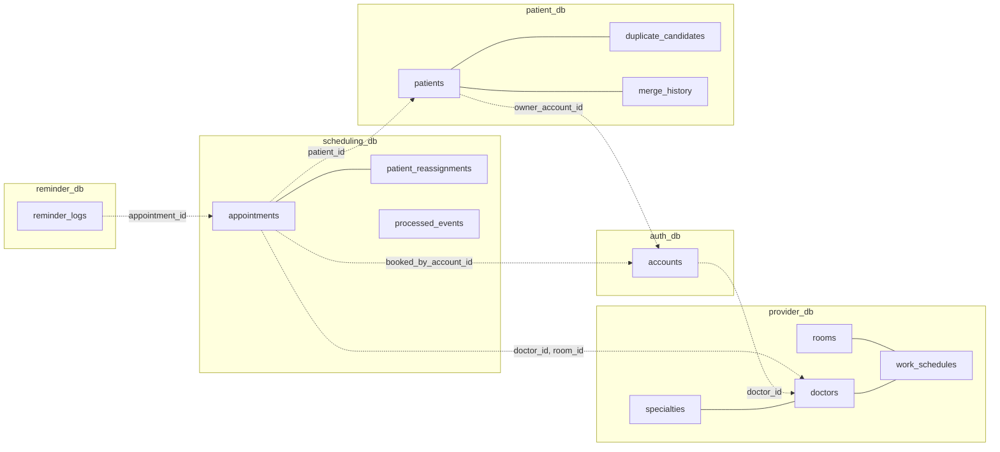
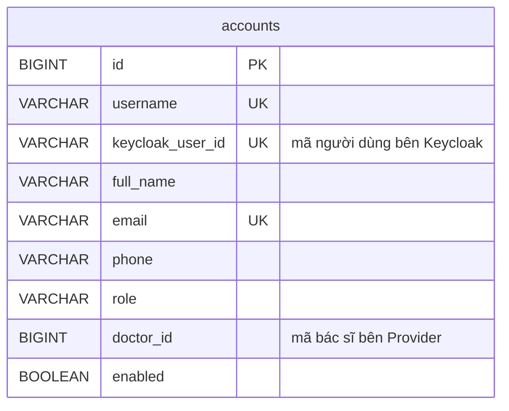
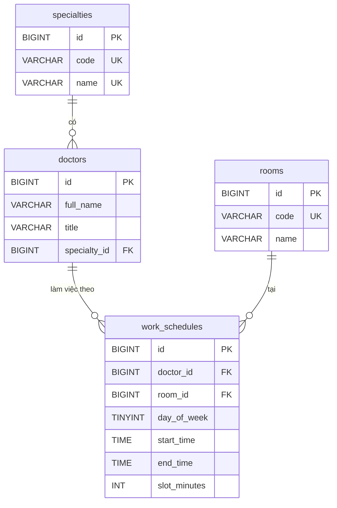
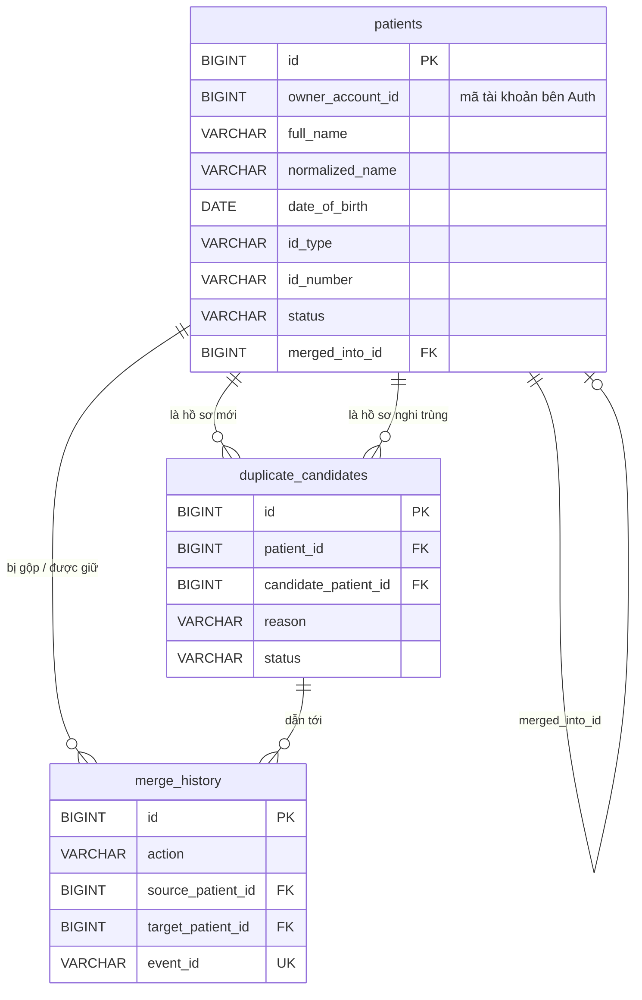
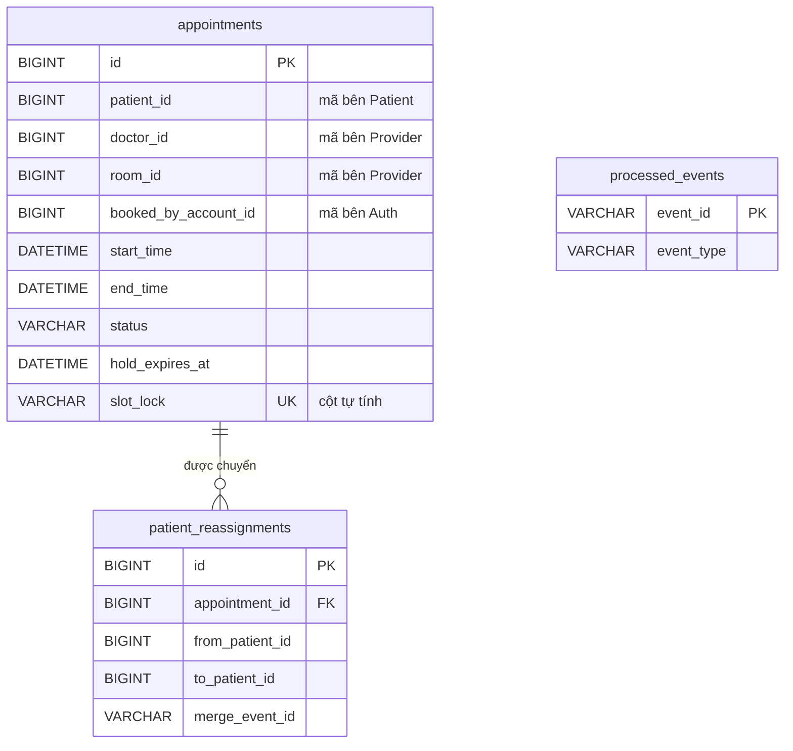

# 03. Thiết kế cơ sở dữ liệu

Tài liệu mô tả **toàn bộ bảng dữ liệu** của 5 service, căn cứ theo mẫu Database per Service (giáo trình trang 88–89). Các bảng đã được tạo sẵn trong code: mỗi service có file `src/main/resources/schema.sql` (tạo bảng) và `data.sql` (dữ liệu mẫu), cùng các lớp entity Java ánh xạ đúng từng cột.

> Bảng dữ liệu là một phần của hợp đồng giữa các phần việc. Thêm hoặc sửa cột cần được thống nhất trước, sau đó sửa đồng thời `schema.sql`, entity và tài liệu này.

## Tổng quan cơ sở dữ liệu theo phần việc

| Phần | Service | Database | Các bảng | Vai trò |
|---|---|---|---|---|
| P4 | Auth Service | [`auth_db`](#31-auth_db--auth-service) | `accounts` | Tài khoản đăng nhập, vai trò, liên kết tài khoản bác sĩ với bác sĩ bên Provider |
| P3 | Provider Service | [`provider_db`](#32-provider_db--provider-service) | `specialties`, `rooms`, `doctors`, `work_schedules` | Danh mục chuyên khoa, phòng, bác sĩ và ca làm việc — nguồn để Scheduling tính slot |
| P1 | Patient Service (MPI) | [`patient_db`](#33-patient_db--patient-service-mpi) | `patients`, `duplicate_candidates`, `merge_history` | Hồ sơ bệnh nhân, hàng chờ duyệt hồ sơ nghi trùng, lịch sử gộp / tách |
| P2 | Scheduling Service | [`scheduling_db`](#34-scheduling_db--scheduling-service) | `appointments`, `patient_reassignments`, `processed_events` | Lịch hẹn và chống đặt trùng slot, lịch hẹn đã chuyển khi gộp hồ sơ, sự kiện đã xử lý |
| P5 | Reminder Service | [`reminder_db`](#35-reminder_db--reminder-service) | `reminder_logs` | Nhật ký gửi nhắc lịch, chống nhắc lặp |

API Gateway (P4) không có database. Các mục chung: [Nguyên tắc chung](#1-nguyên-tắc-chung) · [Sơ đồ quan hệ giữa các database](#2-tổng-quan-ai-giữ-bảng-nào-ai-nhắc-tới-ai) · [Ràng buộc nghiệp vụ](#4-các-ràng-buộc-giải-quyết-bài-toán-nghiệp-vụ) · [Dữ liệu mẫu](#5-dữ-liệu-mẫu-nạp-tự-động-khi-khởi-động) · [Sửa cấu trúc bảng](#6-sửa-cấu-trúc-bảng-thế-nào).

---

## 1. Nguyên tắc chung

| Nguyên tắc | Làm thế nào trong hệ thống này |
|---|---|
| **Database per Service** (mỗi service sở hữu database riêng) | Một máy chủ MySQL chứa **5 database tách biệt**: `auth_db`, `provider_db`, `patient_db`, `scheduling_db`, `reminder_db`. Mỗi service đăng nhập MySQL bằng **tài khoản riêng**, tài khoản đó **chỉ có quyền trên database của mình** (tạo trong `docker/mysql/init/01-create-databases.sh`). Service A muốn đọc bảng của service B cũng không được — MySQL từ chối. |
| **Không khóa ngoại chéo service** | Khi một bảng cần nhắc tới thực thể của service khác (ví dụ lịch hẹn cần biết bệnh nhân nào), bảng chỉ lưu **mã** (`patient_id`) dưới dạng số thường. Muốn biết tên bệnh nhân thì **gọi API** của Patient Service. Khóa ngoại (`FOREIGN KEY`) chỉ dùng **bên trong** một database. |
| **Ràng buộc nghiệp vụ đặt ở database khi có thể** | Chống đặt trùng slot, chống trùng giấy tờ, chống gửi nhắc lặp đều được bảo đảm bằng ràng buộc `UNIQUE` — kể cả khi hai request tới cùng lúc (xem mục 4). |
| **Giờ Việt Nam, không múi giờ** | Cột ngày giờ dùng `DATETIME`, Java dùng `LocalDateTime`. Mọi container chạy múi giờ `Asia/Ho_Chi_Minh`. |
| **Enum lưu dạng chữ** | Cột trạng thái lưu `VARCHAR` + ràng buộc `CHECK`, Java ánh xạ bằng `@Enumerated(EnumType.STRING)`. Đọc database thấy ngay `CONFIRMED` thay vì số `1`. |

**Vì sao một máy chủ MySQL chứa 5 database, không phải 5 máy chủ?** Tách database + tách tài khoản đã bảo đảm không service nào chạm được dữ liệu của service khác (đây là cách "schema per service" của mẫu Database per Service). Chạy 5 máy chủ MySQL tốn thêm khoảng 1–1,5 GB RAM, trong khi máy chạy thử chỉ có 16 GB và còn phải chạy 7 service Java (số đo thực tế ở `docs/01`). Muốn tách hẳn thì chỉ cần thêm container MySQL và đổi `DB_HOST` của service đó trong `docker-compose.yml`, không phải sửa code.

---

## 2. Tổng quan: ai giữ bảng nào, ai nhắc tới ai



- Đường **liền** (`---`): khóa ngoại thật, trong cùng một database.
- Đường **đứt** (`-.->`): chỉ lưu mã, không khóa ngoại; lấy dữ liệu bằng API.

---

## 3. Chi tiết từng database

Ký hiệu cột "Bắt buộc": ✔ = `NOT NULL`.

### 3.1. `auth_db` — Auth Service



**`accounts`** (tài khoản đăng nhập). Mật khẩu, phiên đăng nhập nằm ở Keycloak (`keycloak_db`); bảng này giữ mã số tài khoản và thông tin nghiệp vụ.

| Cột | Kiểu | Bắt buộc | Ý nghĩa |
|---|---|---|---|
| `id` | BIGINT | ✔ | Mã tài khoản; Keycloak lưu thành thuộc tính `accountId`, đưa vào claim `accountId` của token; Gateway gắn thành header `X-User-Id` |
| `username` | VARCHAR(50) | ✔ | Tên đăng nhập, duy nhất, chữ thường (Keycloak tự đổi về chữ thường) |
| `keycloak_user_id` | VARCHAR(36) | | Mã (UUID) người dùng bên Keycloak, duy nhất; dùng để khóa / mở tài khoản qua Admin API |
| `full_name` | VARCHAR(255) | ✔ | Họ tên hiển thị |
| `email` | VARCHAR(255) | | Duy nhất nếu có |
| `phone` | VARCHAR(20) | | |
| `role` | VARCHAR(20) | ✔ | `PATIENT`, `RECEPTIONIST`, `DOCTOR`, `ADMIN` |
| `doctor_id` | BIGINT | | Chỉ với `DOCTOR`: mã bác sĩ bên Provider Service → thuộc tính `doctorId` trong Keycloak, đưa vào token để bác sĩ xem đúng lịch của mình |
| `enabled` | BOOLEAN | ✔ | `false` = khóa tài khoản; khóa / mở thì Auth Service đổi cả người dùng bên Keycloak |
| `created_at`, `updated_at` | DATETIME | ✔ | Tự điền |

### 3.2. `provider_db` — Provider Service



**`specialties`** (chuyên khoa): `id`, `code` (mã ngắn, duy nhất, ví dụ `NOI`), `name` (duy nhất), `description`, `active`.

**`rooms`** (phòng khám): `id`, `code` (duy nhất, ví dụ `P101`), `name`, `location`, `active`.

**`doctors`** (bác sĩ)

| Cột | Kiểu | Bắt buộc | Ý nghĩa |
|---|---|---|---|
| `id` | BIGINT | ✔ | Mã bác sĩ — service khác lưu mã này dưới tên `doctor_id` |
| `full_name` | VARCHAR(255) | ✔ | |
| `title` | VARCHAR(50) | | Học hàm/học vị: `BS`, `ThS.BS`, `BS.CKI`… |
| `specialty_id` | BIGINT | ✔ | Khóa ngoại → `specialties`. Mỗi bác sĩ thuộc **một** chuyên khoa |
| `phone`, `email` | | | |
| `active` | BOOLEAN | ✔ | `false` = ngừng nhận lịch |

**`work_schedules`** (ca làm việc lặp lại hằng tuần)

| Cột | Kiểu | Bắt buộc | Ý nghĩa |
|---|---|---|---|
| `doctor_id` | BIGINT | ✔ | Khóa ngoại → `doctors` |
| `room_id` | BIGINT | ✔ | Khóa ngoại → `rooms`: ca này khám ở phòng nào |
| `day_of_week` | TINYINT | ✔ | 1 = Thứ Hai … 7 = Chủ nhật (theo chuẩn ISO, khớp `java.time.DayOfWeek.of(...)`) |
| `start_time`, `end_time` | TIME | ✔ | Ví dụ 07:30 – 11:30; ràng buộc `start_time < end_time` |
| `slot_minutes` | INT | ✔ | Thời lượng một lượt khám (5 – 120 phút). Ca 07:30–11:30 với 20 phút → 12 slot |
| `effective_from` | DATE | ✔ | Ngày bắt đầu áp dụng |
| `effective_to` | DATE | | Ngày hết áp dụng; `NULL` = chưa hết |
| `active` | BOOLEAN | ✔ | Xóa ca = đặt `false`, không xóa dòng |

> **Cách tính "ca của bác sĩ X ngày D":** lấy các dòng có `doctor_id = X`, `day_of_week = thứ của D`, `active = true`, `effective_from ≤ D` và (`effective_to` rỗng hoặc `≥ D`). Truy vấn này đã có sẵn: `WorkScheduleRepository.findEffective(...)`.

### 3.3. `patient_db` — Patient Service (MPI)



**`patients`** (hồ sơ bệnh nhân)

| Cột | Kiểu | Bắt buộc | Ý nghĩa |
|---|---|---|---|
| `id` | BIGINT | ✔ | Mã hồ sơ — Scheduling lưu mã này dưới tên `patient_id` |
| `owner_account_id` | BIGINT | | Tài khoản `PATIENT` quản lý hồ sơ (mã bên Auth). Một tài khoản quản lý được nhiều hồ sơ (bản thân + con). `NULL` nếu lễ tân tạo tại quầy |
| `created_by_account_id` | BIGINT | ✔ | Ai tạo hồ sơ (bệnh nhân hoặc lễ tân) |
| `full_name` | VARCHAR(255) | ✔ | Họ tên như người dùng nhập |
| `normalized_name` | VARCHAR(255) | ✔ | Họ tên **bỏ dấu, viết thường, gộp khoảng trắng** — "Lê  Thị Hoa" → `le thi hoa`. Dùng để so khớp; service phải tự tính khi lưu |
| `date_of_birth` | DATE | ✔ | |
| `gender` | VARCHAR(10) | ✔ | `MALE`, `FEMALE`, `OTHER` |
| `phone`, `email`, `address` | | | `email` là nơi Reminder gửi nhắc lịch |
| `id_type` | VARCHAR(10) | | `CCCD`, `PASSPORT`, `BHYT` — không bắt buộc |
| `id_number` | VARCHAR(20) | | Số giấy tờ |
| `guardian_name`, `guardian_phone`, `guardian_relation` | | | Người giám hộ (trẻ em, người cao tuổi được đặt hộ) |
| `status` | VARCHAR(10) | ✔ | `TEMPORARY` (tạm) → `ACTIVE` (đang dùng) → `MERGED` (đã gộp) |
| `merged_into_id` | BIGINT | | Khi `MERGED`: gộp vào hồ sơ nào (khóa ngoại tới chính bảng này) |
| `version` | BIGINT | ✔ | Khóa lạc quan (`@Version`): hai người cùng sửa, người lưu sau bị báo lỗi thay vì ghi đè |
| `active_identity` | VARCHAR(40) | | **Cột tự tính, không ánh xạ trong Java** — xem mục 4.1 |

**`duplicate_candidates`** (hàng chờ duyệt hồ sơ nghi trùng)

| Cột | Ý nghĩa |
|---|---|
| `patient_id` | Hồ sơ mới / hồ sơ tạm vừa phát sinh |
| `candidate_patient_id` | Hồ sơ có sẵn bị nghi là cùng người |
| `reason` | `SAME_ID_DIFFERENT_INFO` (tình huống 2: trùng giấy tờ nhưng lệch tên/ngày sinh), `SAME_NAME_DOB_PHONE` (tình huống 3: không giấy tờ, trùng tên + ngày sinh + SĐT), `ID_ADDED_BELONGS_TO_OTHER` (tình huống 5: bổ sung giấy tờ đã thuộc hồ sơ khác) |
| `score` | Điểm giống nhau **chỉ để lễ tân tham khảo** (tính bằng lớp `MatchScorer`, chuyển từ code MPI). Không bao giờ dùng để tự gộp |
| `status` | `PENDING` (chờ) → `MERGED` (đã gộp) hoặc `NOT_DUPLICATE` (lễ tân xác nhận không trùng) |
| `reviewed_by_account_id`, `reviewed_at`, `review_note` | Ai duyệt, lúc nào, ghi chú |

Cặp (`patient_id`, `candidate_patient_id`) là duy nhất → không đưa một cặp vào hàng chờ hai lần.

**`merge_history`** (lịch sử gộp / tách)

| Cột | Ý nghĩa |
|---|---|
| `action` | `MERGE` hoặc `UNMERGE` |
| `source_patient_id` | Hồ sơ bị gộp (B) |
| `target_patient_id` | Hồ sơ được giữ lại (A) |
| `source_previous_status` | Trạng thái của B **trước** khi gộp — để khi tách trả B về đúng trạng thái cũ |
| `duplicate_candidate_id` | Cặp trong hàng chờ đã dẫn tới lần gộp này |
| `related_merge_id` | Với `UNMERGE`: trỏ về dòng `MERGE` mà lần tách này hoàn tác |
| `event_id` | Mã sự kiện (UUID) đã phát qua RabbitMQ — duy nhất |
| `performed_by_account_id`, `performed_at`, `note` | Ai làm, lúc nào, ghi chú |

### 3.4. `scheduling_db` — Scheduling Service



**`appointments`** (lịch hẹn)

| Cột | Kiểu | Bắt buộc | Ý nghĩa |
|---|---|---|---|
| `patient_id` | BIGINT | ✔ | Mã hồ sơ bên Patient (không khóa ngoại) |
| `doctor_id` | BIGINT | ✔ | Mã bác sĩ bên Provider (không khóa ngoại) |
| `room_id`, `work_schedule_id` | BIGINT | | Chép từ ca làm việc lúc giữ chỗ, để không phải hỏi lại Provider |
| `booked_by_account_id` | BIGINT | ✔ | Tài khoản đã đặt (bên Auth) — "lịch của tôi" lọc theo cột này |
| `start_time`, `end_time` | DATETIME | ✔ | Giờ bắt đầu / kết thúc slot |
| `status` | VARCHAR(12) | ✔ | `HELD` → `CONFIRMED` → `COMPLETED`; `CONFIRMED` → `NO_SHOW` (không đến, CS10); `HELD` → `EXPIRED`; `CONFIRMED` → `CANCELLED` |
| `hold_expires_at` | DATETIME | | Hạn giữ chỗ = lúc giữ + `scheduling.hold-minutes` (mặc định 5 phút) |
| `reason` | VARCHAR(500) | | Lý do khám bệnh nhân nhập |
| `cancel_reason`, `cancelled_by_account_id`, `cancelled_at` | | | Thông tin hủy |
| `confirmed_at`, `completed_at`, `no_show_at` | DATETIME | | Lúc xác nhận, lúc đánh dấu đã khám, lúc ghi không đến |
| `version` | BIGINT | ✔ | Khóa lạc quan |
| `slot_lock` | VARCHAR(50) | | **Cột tự tính, không ánh xạ trong Java** — xem mục 4.2 |

**`patient_reassignments`** (lịch hẹn đã chuyển khi gộp hồ sơ): `appointment_id` (khóa ngoại → `appointments`), `from_patient_id`, `to_patient_id`, `merge_event_id` (eventId của sự kiện gộp), `reassigned_at`, `reverted_at` (có giá trị khi đã hoàn lại do tách hồ sơ).

**`processed_events`** (sự kiện đã xử lý): `event_id` là khóa chính. Trước khi xử lý một sự kiện từ RabbitMQ, kiểm tra `event_id` đã có chưa → có rồi thì bỏ qua. RabbitMQ có thể giao một tin nhắn **hơn một lần**, bảng này bảo đảm xử lý đúng một lần (idempotent — làm lại cũng không đổi kết quả).

### 3.5. `reminder_db` — Reminder Service

**`reminder_logs`** (nhật ký gửi nhắc)

| Cột | Ý nghĩa |
|---|---|
| `appointment_id`, `patient_id` | Mã bên Scheduling / Patient (không khóa ngoại) |
| `appointment_start` | Giờ khám (chép lại để hiển thị, khỏi gọi Scheduling) |
| `reminder_type` | Hiện chỉ có `BEFORE_APPOINTMENT` |
| `recipient_email` | Email đã gửi tới |
| `status` | `SENT` (đã gửi), `FAILED` (lỗi, lần quét sau thử lại), `SKIPPED` (hồ sơ không có email) |
| `attempt_count`, `last_error` | Số lần thử, lỗi gần nhất |
| `sent_at` | Lúc gửi thành công |

Cặp (`appointment_id`, `reminder_type`) là duy nhất → mỗi lịch chỉ được nhắc một lần dù cron chạy bao nhiêu lần.

---

## 4. Các ràng buộc giải quyết bài toán nghiệp vụ

### 4.1. Một giấy tờ chỉ thuộc một hồ sơ đang dùng — `uk_patients_active_identity`

```sql
active_identity VARCHAR(40) GENERATED ALWAYS AS (
    IF(status = 'ACTIVE' AND id_number IS NOT NULL, CONCAT(id_type, ':', id_number), NULL)) STORED,
CONSTRAINT uk_patients_active_identity UNIQUE (active_identity)
```

- Hồ sơ `ACTIVE` có CCCD `048190001234` → cột tự tính = `CCCD:048190001234`, ràng buộc `UNIQUE` không cho hồ sơ `ACTIVE` thứ hai mang cùng giá trị.
- Hồ sơ `TEMPORARY` → cột = `NULL`. MySQL cho nhiều `NULL` trong cột `UNIQUE`, nên hồ sơ tạm **được phép** mang giấy tờ trùng để chờ lễ tân duyệt (tình huống 2 và 5).

### 4.2. Chống đặt trùng slot — `uk_appointments_slot_lock`

```sql
slot_lock VARCHAR(50) GENERATED ALWAYS AS (
    IF(status IN ('HELD', 'CONFIRMED', 'COMPLETED', 'NO_SHOW'), CONCAT(doctor_id, '@', start_time), NULL)) STORED,
CONSTRAINT uk_appointments_slot_lock UNIQUE (slot_lock)
```

`NO_SHOW` vẫn giữ khóa như `COMPLETED`: giờ khám đã qua, slot không mở lại cho người khác.

Hai người cùng bấm giữ slot 08:00 của bác sĩ 1 **cùng lúc**:

```
Người A: INSERT ... status = HELD → slot_lock = '1@2026-10-05 08:00:00' → thành công
Người B: INSERT ... status = HELD → slot_lock = '1@2026-10-05 08:00:00' → MySQL báo trùng UNIQUE
         → Scheduling Service bắt lỗi DataIntegrityViolationException → trả 409 SLOT_ALREADY_HELD
```

Lịch `EXPIRED` / `CANCELLED` có `slot_lock = NULL` nên slot được nhả cho người khác. Không cần khóa trong Java hay `synchronized` — database làm trọng tài, và vẫn đúng khi chạy nhiều bản Scheduling Service cùng lúc.

**Lưu ý khi viết code giữ chỗ:** lịch `HELD` đã quá `hold_expires_at` nhưng chưa được chuyển sang `EXPIRED` vẫn còn giữ khóa. Trước khi `INSERT`, gọi `AppointmentRepository.expireHolds(now)` (hoặc chạy nó định kỳ bằng `@Scheduled`).

### 4.3. Không nhắc lặp — `uk_reminder_logs_appointment`, và không xử lý sự kiện lặp — `processed_events`

Cùng một ý tưởng: **ghi dấu vào database trước/sau khi làm**, ràng buộc khóa chính/`UNIQUE` chặn lần thứ hai.

---

## 5. Dữ liệu mẫu (nạp tự động khi khởi động)

Các file `data.sql` dùng `INSERT IGNORE` với **mã cố định**, nên khởi động lại không bị nhân đôi, và mã giữa các service khớp nhau (ví dụ lịch hẹn 5 ở Scheduling trỏ tới hồ sơ 9 ở Patient, bác sĩ 1 ở Provider, tài khoản 2 ở Auth). Dữ liệu minh họa đủ các trạng thái và tình huống nghiệp vụ để có cái xem ngay khi chạy.

| Bảng | Số dòng |
|---|---|
| `accounts` | 11 |
| `specialties` / `rooms` / `doctors` / `work_schedules` | 5 / 6 / 6 / 25 |
| `patients` | 10 |
| `duplicate_candidates` / `merge_history` | 3 / 1 |
| `appointments` / `patient_reassignments` / `processed_events` | 14 / 1 / 1 |
| `reminder_logs` | 5 |

**Tài khoản** (mật khẩu chung `123456`)

| id | username | Vai trò | Ghi chú |
|---|---|---|---|
| 1 | `admin` | ADMIN | |
| 2 | `letan` | RECEPTIONIST | |
| 3 | `bs.an` | DOCTOR | `doctor_id = 1` |
| 4 | `bs.binh` | DOCTOR | `doctor_id = 2` |
| 5 | `benhnhan` | PATIENT | Quản lý hồ sơ 1, 2 |
| 6 – 9 | `bs.cuong`, `bs.dung`, `bs.em`, `bs.giang` | DOCTOR | `doctor_id` = 3, 4, 5, 6 |
| 10 | `nam.tran` | PATIENT | Quản lý hồ sơ 4, 5 |
| 11 | `lan.pham` | PATIENT | Quản lý hồ sơ 6 |

**Bác sĩ và lịch làm việc**

| id | Bác sĩ | Chuyên khoa | Phòng | Lịch (slot) |
|---|---|---|---|---|
| 1 | ThS.BS Nguyễn Văn An | Nội tổng quát | P101 | T2–T6 07:30–11:30; chiều T2, T4 13:30–16:30 (20 phút) |
| 2 | BS.CKI Trần Thị Bình | Nhi khoa | P102 | T2–T7 07:30–11:30 (15 phút) |
| 3 | BS Lê Minh Cường | Tai Mũi Họng | P201 | Chiều T3, T5 13:30–16:30 (20 phút) |
| 4 | BS Phạm Thu Dung | Răng Hàm Mặt | P202 | T2, T4, T6 08:00–11:00 (30 phút) |
| 5 | TS.BS Hoàng Văn Em | Da liễu | P203 | T4, T6, T7 07:30–11:30 (20 phút) |
| 6 | BS Võ Thị Giang | Nội tổng quát | P103 | Chiều T2, T3, T5, T6 13:30–16:30 (20 phút) |

**Hồ sơ bệnh nhân**

| id | Họ tên | Trạng thái | Minh họa |
|---|---|---|---|
| 1 | Lê Thị Hoa (1990) | ACTIVE | Có CCCD, thuộc tài khoản `benhnhan` |
| 2 | Lê Minh Khôi (2018) | TEMPORARY | Trẻ em chưa có giấy tờ, người giám hộ là mẹ (hồ sơ 1) |
| 3 | Le Thi Hoa (1990) | TEMPORARY | Tình huống 3: lễ tân tạo tại quầy, không giấy tờ, trùng tên + ngày sinh + SĐT với hồ sơ 1 → **chờ duyệt** |
| 4 | Trần Văn Nam (1985) | ACTIVE | Có CCCD, thuộc tài khoản `nam.tran` |
| 5 | Trần Gia Bảo (2016) | TEMPORARY | Trẻ em, người giám hộ là bố (hồ sơ 4) |
| 6 | Phạm Thị Lan (1972) | ACTIVE | Dùng thẻ BHYT làm giấy tờ |
| 7 | Nguyễn Văn Hùng (1958) | ACTIVE | Người cao tuổi, lễ tân tạo tại quầy, không có email |
| 8 | Nguyễn Văn Hùng (1958, ngày sinh gõ nhầm) | TEMPORARY | Tình huống 2: cùng CCCD với hồ sơ 7 nhưng lệch ngày sinh → **chờ duyệt**; vẫn có lịch hẹn |
| 9 | Lê Văn Tâm (1990) | ACTIVE | Hồ sơ được giữ lại sau một lần gộp |
| 10 | Le Van Tam (1990) | MERGED | Đã gộp vào hồ sơ 9 (có `merge_history`, lịch hẹn đã chuyển sang hồ sơ 9) |

**Hàng chờ duyệt:** cặp 3–1 (`SAME_NAME_DOB_PHONE`, 60 điểm) và 8–7 (`SAME_ID_DIFFERENT_INFO`, 80 điểm) đang `PENDING`; cặp 10–9 đã `MERGED`.

**Lịch hẹn** — ngày tính theo **ngày chạy lần đầu** nên luôn nằm quanh hiện tại, và mọi giờ đều khớp ca làm việc + độ dài slot của bác sĩ:

| Thời điểm | Lịch hẹn |
|---|---|
| Thứ Hai tuần trước | 5 lịch `COMPLETED`, 1 lịch `CANCELLED` |
| Ngày làm việc gần nhất của bác sĩ nhi (ngày mai, hoặc thứ Hai nếu ngày mai là Chủ nhật) | 1 lịch `CONFIRMED` — dùng để thử nhắc lịch |
| Thứ Hai, thứ Ba tuần tới | 6 lịch `CONFIRMED`, 1 lịch `EXPIRED` (giữ chỗ không xác nhận kịp) |

**Nhật ký nhắc lịch:** 4 lần `SENT` (1 lần phải thử lại), 1 lần `SKIPPED` vì hồ sơ không có email.

Ngày tính theo lúc cơ sở dữ liệu được tạo lần đầu. Sau một thời gian, chạy `docker compose down -v` rồi `docker compose up -d` để tạo lại dữ liệu quanh ngày hiện tại.

---

## 6. Sửa cấu trúc bảng thế nào

`schema.sql` dùng `CREATE TABLE IF NOT EXISTS`: bảng **đã có** thì bỏ qua, **không** tự thêm cột mới. Vì vậy sau khi sửa `schema.sql`:

```powershell
docker compose down -v      # -v xóa luôn volume MySQL → mất toàn bộ dữ liệu của máy đang chạy
docker compose up -d --build
```

Lệnh chỉ ảnh hưởng máy đang chạy. Dữ liệu mẫu được nạp lại từ `data.sql`.

---

## 7. Đối chiếu với thiết kế MPI trước đây

Bảng đối chiếu cột dữ liệu của repo MPI cũ với thiết kế này: `docs/05`, mục 3.
