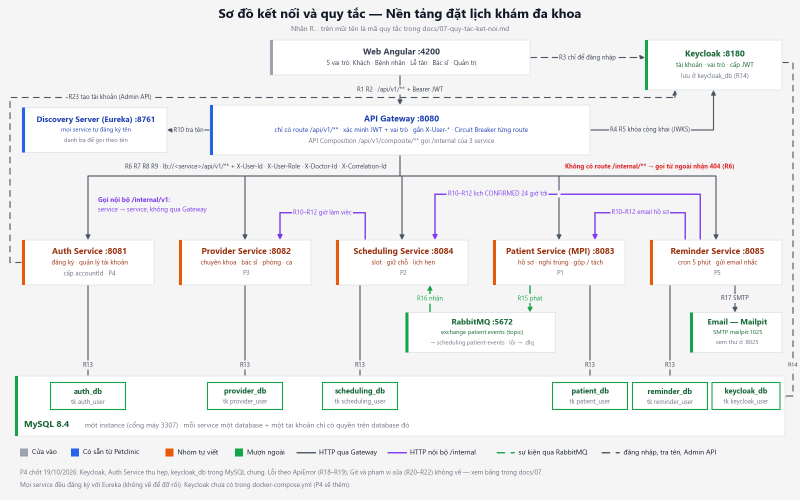

# 07. Quy tắc kết nối giữa các thành phần — bản tóm tắt để chốt

File này là bản tóm tắt để chốt trong buổi họp; bản chi tiết là [`docs/06` Phần A](06-danh-sach-api-hop-dong-giua-cac-service-can-tuan-thu.md#phần-a--quy-tắc-chung). Khi hai bản khác nhau, `docs/06` là bản chuẩn.

Vẽ lại hình: `python docs/so-do/ve_so_do_ket_noi.py` (ra cả `.png` và `.svg`). Nhãn `R…` trên mũi tên ứng với mã trong bảng dưới.

Quyết định mới (19/10/2026) thay thế phương án tự viết Auth: P4 dùng **Keycloak** (máy chủ quản lý đăng nhập mã nguồn mở) làm Identity Provider (nơi cấp danh tính). Phần Gateway + Auth (P4) người phụ trách P4 đã chốt cùng ngày — xem mục [Quyết định và câu còn mở](#quyết-định-và-câu-còn-mở).

## Bảng quy tắc

| Mã | Quy tắc | Ví dụ cụ thể | Chi tiết ở |
|---|---|---|---|
| **Web → Gateway** | | | |
| R1 | Web chỉ gọi API qua Gateway, đường dẫn `/api/v1/...`; không gọi thẳng cổng của service | `GET http://localhost:8080/api/v1/doctors?specialtyId=1` (lấy từ `environment.apiUrl`) | [docs/06 A1](06-danh-sach-api-hop-dong-giua-cac-service-can-tuan-thu.md#a1-đường-dẫn) |
| R2 | Mọi request sau khi đăng nhập gửi `Authorization: Bearer <JWT>` (JSON Web Token — thẻ đăng nhập có chữ ký); web không tự gửi `X-User-*` khi đã bỏ Chế độ thử | interceptor (bộ chặn request) của Angular gắn header này cho mọi lời gọi | [docs/06 A5](06-danh-sach-api-hop-dong-giua-cac-service-can-tuan-thu.md#a5-đăng-nhập-và-danh-tính), [docs/04 6.3](04-cac-viec-can-trien-khai.md#63-web) |
| **Gateway ↔ Keycloak (xác thực)** | | | |
| R3 | Web chỉ nói chuyện với Keycloak để đăng nhập (đã chốt câu 3: chuyển sang trang đăng nhập của Keycloak, không giữ form mật khẩu trên web) | Web chuyển sang trang đăng nhập Keycloak, nhận lại access token (thẻ truy cập) | [docs/02 3.3](02-mo-ta-de-tai-va-he-thong.md#33-đối-chiếu-với-giáo-trình) |
| R4 | Keycloak giữ tài khoản, mật khẩu, vai trò; token phải có claim (trường dữ liệu trong token) `accountId` (số), `role`, `doctorId`, `exp` | Token của `benhnhan`: `accountId = 5`, `role = PATIENT`, `doctorId = null` | [docs/06 A5](06-danh-sach-api-hop-dong-giua-cac-service-can-tuan-thu.md#a5-đăng-nhập-và-danh-tính) |
| R5 | Gateway xác minh chữ ký và hạn dùng bằng khóa công khai của Keycloak (JWKS — danh sách khóa công khai); token sai, hết hạn → `401 UNAUTHORIZED`. Gateway tự so chữ ký, **không gọi Keycloak cho từng request**; đường dẫn công khai (ví dụ đăng ký) cho qua không cần token | Gateway đọc khóa ở `http://keycloak:8080/realms/<realm>/protocol/openid-connect/certs` | [docs/04 P4-4](04-cac-viec-can-trien-khai.md#62-api-gateway) |
| R23 | Chỉ Auth Service gọi Keycloak Admin API (API quản trị) để tạo, sửa tài khoản; tài khoản quản trị Keycloak chỉ nằm phía máy chủ, web không bao giờ giữ (đã chốt câu 1) | Đăng ký: Web → Gateway `POST /api/v1/auth/register` → Auth Service cấp `accountId` → tạo người dùng trong Keycloak | [docs/04 P4-1](04-cac-viec-can-trien-khai.md#61-auth-service) |
| **Gateway → service** | | | |
| R6 | Gateway chỉ có route (tuyến chuyển tiếp) cho `/api/v1/**`; **không** có route `/internal/**`; `/api/v1/composite/**` do Gateway tự ghép; mỗi route một Circuit Breaker (bộ ngắt mạch) riêng (đã chốt câu 7) | `GET :8080/internal/v1/patients?ids=1` → 404 | [docs/06 A1](06-danh-sach-api-hop-dong-giua-cac-service-can-tuan-thu.md#a1-đường-dẫn) |
| R7 | Gateway xóa `X-User-*`, `X-Doctor-Id` do client tự gửi, rồi gắn `X-User-Id`, `X-User-Role`, `X-Doctor-Id`, `X-Correlation-Id` (mã truy vết request) | Gửi `X-User-Id: 1` kèm token của tài khoản 5 → service vẫn nhận `5` | [docs/06 A5](06-danh-sach-api-hop-dong-giua-cac-service-can-tuan-thu.md#a5-đăng-nhập-và-danh-tính) |
| R8 | Service không đọc JWT, chỉ tin header; service tự kiểm quyền trên từng bản ghi (`403 FORBIDDEN`); API ghi **(GW)** thì Gateway chặn thô theo vai trò trước (đã chốt câu 5: 9 API còn thiếu được ghi thêm **(GW)**, riêng `GET /api/v1/appointments/{id}` do service tự kiểm) | Bệnh nhân 5 xem hồ sơ của tài khoản 10 → 403 | [docs/06 A5](06-danh-sach-api-hop-dong-giua-cac-service-can-tuan-thu.md#a5-đăng-nhập-và-danh-tính), [Phần B](06-danh-sach-api-hop-dong-giua-cac-service-can-tuan-thu.md#phần-b--danh-sách-api) |
| R9 | Đường dẫn danh từ số nhiều có gạch ngang; `GET` 200, `POST` tạo 201, `PUT` 200, `DELETE` 204, hành động `POST /{id}/<động-từ>` 200; JSON camelCase, ngày giờ không kèm múi giờ | `POST /api/v1/appointments/12/confirm` → 200; `"startTime": "2026-10-05T08:00:00"` | [A2](06-danh-sach-api-hop-dong-giua-cac-service-can-tuan-thu.md#a2-phương-thức-http-và-mã-trả-về), [A3](06-danh-sach-api-hop-dong-giua-cac-service-can-tuan-thu.md#a3-dữ-liệu-json) |
| **Service ↔ service** | | | |
| R10 | Gọi nhau theo **tên service** qua Eureka (danh bạ service), bằng `RestClient`/`WebClient` gắn `@LoadBalanced`; không ghi IP, cổng | `http://provider-service/internal/v1/doctors/1/working-hours?date=2026-10-05` | [docs/06 A6](06-danh-sach-api-hop-dong-giua-cac-service-can-tuan-thu.md#a6-service-gọi-service) |
| R11 | Chỉ gọi `/internal/v1/...` (hoặc API công khai có sẵn); mỗi service tự khai `record` cho dữ liệu nhận về; không dùng chung code | Scheduling tự có `WorkingHours`, không chép lớp của Provider | [docs/06 A6](06-danh-sach-api-hop-dong-giua-cac-service-can-tuan-thu.md#a6-service-gọi-service) |
| R12 | Lời gọi đồng bộ phải có timeout (thời gian chờ tối đa) và phương án khi lỗi; chuyển tiếp `X-Correlation-Id` (đã chốt câu 9: P4 làm) | Provider tắt → Scheduling trả 503; Reminder lỗi → thử lại ở lần quét sau | [docs/06 A6](06-danh-sach-api-hop-dong-giua-cac-service-can-tuan-thu.md#a6-service-gọi-service) |
| **Service → database riêng** | | | |
| R13 | Mỗi service chỉ kết nối database của mình bằng tài khoản MySQL riêng; bảng chỉ lưu **mã** của thực thể service khác, không khóa ngoại chéo | Scheduling dùng `scheduling_db` / `scheduling_user`, không đọc `patient_db` | [docs/03 mục 1](03-thiet-ke-csdl.md#1-nguyên-tắc-chung) |
| R14 | Keycloak cũng có database riêng `keycloak_db` + tài khoản `keycloak_user`, nằm trong container MySQL chung (đã chốt câu 2) | Thêm một dòng `create_db keycloak_db keycloak_user …` trong `docker/mysql/init` | — |
| **Sự kiện qua RabbitMQ** | | | |
| R15 | Patient phát sự kiện lên exchange (bộ phân phối tin nhắn) `patient.events` (loại topic), routing key (khóa định tuyến) `patient.merged` / `patient.unmerged`, **sau khi** commit database | Gộp hồ sơ 3 vào 1 → một tin `PATIENT_MERGED` | [docs/06 A7](06-danh-sach-api-hop-dong-giua-cac-service-can-tuan-thu.md#a7-sự-kiện-qua-rabbitmq) |
| R16 | Scheduling nghe hàng đợi `scheduling.patient-events` (gắn `patient.*`); xử lý lỗi → qua `patient.events.dlx` vào `scheduling.patient-events.dlq` (DLQ — hàng đợi tin lỗi); bỏ qua `eventId` đã có trong `processed_events` | Gửi lại cùng một sự kiện → lịch chỉ chuyển một lần | [docs/06 A7](06-danh-sach-api-hop-dong-giua-cac-service-can-tuan-thu.md#a7-sự-kiện-qua-rabbitmq) |
| R17 | Reminder gửi email qua SMTP (giao thức gửi thư) tới Mailpit (hộp thư giả lập) `mailpit:1025`; xem thư ở `http://localhost:8025` | Bấm "Quét ngay" → thư xuất hiện trong Mailpit | [docs/06 B5](06-danh-sach-api-hop-dong-giua-cac-service-can-tuan-thu.md#b5-reminder-service--reminder-service8085) |
| **Lỗi** | | | |
| R18 | Mọi lỗi trả cùng dạng `ApiError` {timestamp, status, error, message, path}; `error` viết HOA_GẠCH_DƯỚI; lỗi nghiệp vụ ném `BusinessException` | `409 {"error": "SLOT_ALREADY_HELD", …}` | [docs/06 A4](06-danh-sach-api-hop-dong-giua-cac-service-can-tuan-thu.md#a4-lỗi) |
| R19 | Lỗi do Gateway trả (401, 403 của **(GW)**, 404, 503) cũng phải đúng dạng `ApiError` | Provider tắt → `503 SERVICE_UNAVAILABLE` có đủ 5 trường | [docs/06 A4](06-danh-sach-api-hop-dong-giua-cac-service-can-tuan-thu.md#a4-lỗi) |
| **Git và phạm vi sửa** | | | |
| R20 | Mỗi phần chỉ sửa thư mục service của mình và trang web của mình; file dùng chung (`docker-compose.yml`, `pom.xml` gốc, `docs/03`, `docs/06`, `app-pages.ts`) sửa qua Pull Request (yêu cầu gộp code) riêng sau khi thống nhất | P2 không sửa `provider-service/` | [docs/04 1.3](04-cac-viec-can-trien-khai.md#13-phạm-vi-sửa) |
| R21 | Đổi đường dẫn, tên trường, mã lỗi, cấu trúc bảng là **đổi hợp đồng**: báo các phần đang dùng và sửa tài liệu cùng lúc | Đổi `X-User-Id` sang chuỗi → báo P1, P2, P3, P5 | [docs/04 1.3](04-cac-viec-can-trien-khai.md#13-phạm-vi-sửa) |
| R22 | Mỗi việc một nhánh `feature/<service>-<việc>`, Pull Request vào `main` có ít nhất một người duyệt; `main` luôn chạy được `docker compose up -d --build`; không commit `.env` | `feature/scheduling-hold-slot` | [docs/04 1.4](04-cac-viec-can-trien-khai.md#14-git) |

## Tác động của Keycloak

| Chỗ phải đổi | Nội dung |
|---|---|
| `docker-compose.yml` | Thêm container `keycloak` (cố định số phiên bản ảnh), cổng máy `8180`, nạp realm (vùng quản lý tài khoản) từ file JSON trong repo bằng `--import-realm` (thư mục `/opt/keycloak/data/import`). Bỏ biến `JWT_SECRET` (dòng 87, 114). Từ 11 lên 12 container |
| Database | Dùng chung MySQL (câu 2): thêm `keycloak_db` + `keycloak_user` vào `docker/mysql/init/01-create-databases.sh`. Script này chỉ chạy khi volume trống → mỗi máy phải `docker compose down -v` **một lần** (dữ liệu mẫu tự nạp lại) |
| Token | `sub` của Keycloak là UUID (chuỗi), không phải số → cần thuộc tính người dùng `accountId`, `doctorId` và protocol mapper (bộ ánh xạ trường vào token) để token có `accountId`, `role`, `doctorId`. Gateway lấy `X-User-Id` từ `accountId`, không từ `sub` |
| API Gateway | Thay phần xác minh HS256 bằng xác minh RS256 qua JWKS; thư viện JJWT trong `api-gateway/pom.xml` không còn cần. Trường `iss` (nơi phát token) mang địa chỉ trình duyệt thấy (`localhost:8180`) trong khi Gateway lấy khóa qua tên nội bộ `keycloak:8080` → phải cấu hình hostname của Keycloak cho khớp |
| auth-service | Thu hẹp (câu 1 = B): giữ bảng `accounts` làm nguồn `accountId` và `doctorId`; bỏ mật khẩu và phần cấp JWT; đăng ký, quản trị tạo tài khoản thì gọi Keycloak Admin API (R23). P4-1 – P4-3 viết lại theo hướng này |
| Web | Trang đăng nhập, đăng ký theo câu 3; interceptor gắn `Bearer`; Keycloak phải cho phép origin (nguồn gọi) `http://localhost:4200` |
| Dữ liệu mẫu | Realm phải có đúng **11 tài khoản** với `accountId` 1–11 như `auth-service/.../data.sql`, vì Patient và Scheduling đã dùng các mã 2, 5, 10, 11 trong dữ liệu mẫu |
| Tài liệu | `docs/06` A5 (bước 1, cột "claim", đoạn JWT) và B1; `docs/04` P4-1 – P4-4 (cột *Xong khi*: "jwt.io thấy `sub = 5`" → `accountId = 5`), P4-9; `docs/02` mục 3.3, 4, 6, 9; `docs/03` mục 3.1; `docs/01` (cách chạy, tài khoản quản trị Keycloak) |
| RAM | Tài liệu Keycloak ghi: một Pod (đơn vị chạy) dùng nền **1250 MB** (đã gồm bộ đệm 10.000 phiên), đề xuất giới hạn **1360 MB**; heap Java = 70% giới hạn, thêm khoảng 300 MB ngoài heap ([keycloak.org — CPU and memory sizing](https://www.keycloak.org/high-availability/multi-cluster/concepts-memory-and-cpu-sizing)). Đây là cấu hình cụm sản xuất nên là **mức trên**. Ước lượng: 2,2 GB hiện tại + 1,25 GB ≈ **3,45 GB < 5 GB** của WSL. Lưu ý: tổng `mem_limit` hiện là 4.736 MB, thêm 1.360 MB thành 6.096 MB — vượt 5 GB nếu mọi container cùng chạm trần (thực tế không xảy ra cùng lúc). Số liệu thật phải đo bằng `docker stats` sau khi thêm |

## Quyết định và câu còn mở

Câu 1, 2, 3, 4, 5, 7, 9 thuộc phần P4 (Gateway + Auth), người phụ trách P4 đã chốt ngày 19/10/2026 theo khuyến nghị. Câu 6, 8, 10 chạm phần của nhiều người; chốt cùng ngày: phương án A, làm trong phần chuẩn bị chung trước khi nhóm bắt đầu code để không ai phải sửa thư mục của người khác (đã làm, xem [`00a`](00a-nhung-gi-da-san-sang.md)).

| # | Câu hỏi | Kết quả | Lý do (một dòng) |
|---|---|---|---|
| 1 | auth-service: **A** bỏ hẳn, hay **B** thu hẹp (giữ bảng `accounts` làm nguồn mã số + `doctorId`, bỏ mật khẩu và JWT; đăng ký, quản trị tạo tài khoản thì gọi Keycloak Admin API)? | **B — đã chốt** | Giữ `X-User-Id` là số nên P1, P2, P3, P5 và dữ liệu mẫu không đổi; chọn A thì tài khoản tự đăng ký mới không có mã số, phải bỏ P4-1 hoặc đổi hợp đồng sang UUID |
| 2 | Keycloak lưu dữ liệu ở **A** database `keycloak_db` trong container MySQL hiện có, hay **B** container database riêng? | **A — đã chốt** | Keycloak hỗ trợ chính thức MySQL 8.4 ([keycloak.org/server/db](https://www.keycloak.org/server/db)); không thêm container, vẫn đúng "mỗi thành phần một database + tài khoản riêng" |
| 3 | Đăng nhập trên web: **A** chuyển sang trang đăng nhập của Keycloak (OIDC Authorization Code + PKCE — luồng đăng nhập chuẩn có mã chống giả), hay **B** giữ form của web, gửi mật khẩu qua auth-service để đổi lấy token? | **A — đã chốt** | Đúng lý do chọn Keycloak (an toàn); cách B là password grant, bị [RFC 9700 (01/2025) mục 2.4](https://www.rfc-editor.org/rfc/rfc9700.html) ghi "MUST NOT be used". Hệ quả: thêm một thư viện Angular (cần đồng ý) |
| 4 | Mã tài khoản trong header: **A** giữ số (claim `accountId`), hay **B** đổi sang UUID của Keycloak? | **A — đã chốt** | B là đổi hợp đồng (R21) chạm cả 4 service, cột cơ sở dữ liệu và dữ liệu mẫu |
| 5 | 9 API chỉ phân quyền theo vai trò nhưng service không nhận header vai trò (phụ lục, L2): **A** đánh dấu thêm **(GW)** để Gateway chặn, hay **B** từng service tự thêm `@RequestHeader("X-User-Role")`? | **A — đã chốt**, riêng `GET /api/v1/appointments/{id}` theo **B** | Chặn theo vai trò ở một chỗ thì ít sót; API kiểm theo bản ghi thì chỉ service làm được |
| 6 | Timeout cho lời gọi nội bộ: **A** đặt một lần trong `ClientConfig` (Scheduling, Reminder) và `WebClient` của Gateway qua một PR chung, hay **B** mỗi phần tự đặt? | **A — đã chốt**, đã làm: `clinic.client-timeout = 3s` | Một giá trị thống nhất (ví dụ 3 giây), tránh có phần quên |
| 7 | Circuit Breaker (bộ ngắt mạch) ở Gateway: **A** tách mỗi route một tên, hay **B** giữ một tên chung? | **A — đã chốt** | Tên chung → một service lỗi nhiều có thể mở mạch chặn cả 5 route |
| 8 | Lỗi ngoài `ApiError` (L5, L6): **A** sửa chung một lần (Gateway trả `ApiError`; 5 service thêm xử lý 404, 405), hay **B** để từng phần? | **A — đã chốt**, đã làm | Năm `GlobalExceptionHandler` đang giống hệt nhau; sửa riêng sẽ lệch nhau |
| 9 | Chuyển tiếp `X-Correlation-Id` khi service gọi service: **A** giao P4 làm cùng P4-7, hay **B** bỏ? | **A — đã chốt** | `docs/06` A5 đã yêu cầu nhưng `docs/04` chưa giao ai |
| 10 | Các lệch tài liệu nhẹ (L7, L9, L12) và phần Keycloak của `docs/06` A5, B1: **A** gom một PR tài liệu sau họp, hay **B** từng người tự sửa? | **A — đã chốt**, Lập viết (C-5) | Một PR dễ duyệt; `docs/06` là file dùng chung (R20) |

## Phụ lục: chỗ lệch giữa code và tài liệu

Kiểm ngày 19/10/2026 trên nhánh `docs/quy-tac-ket-noi-va-so-do`, đọc code, chưa chạy hệ thống. Khớp tài liệu: route của Gateway, cổng, tên database và tài khoản MySQL, tên exchange/hàng đợi, các trường của `ApiError`, cách gọi theo tên qua `@LoadBalanced`, `apiUrl` của web.

| # | Mức | Chỗ lệch | Vị trí |
|---|---|---|---|
| L1 | Nặng (khi dùng Keycloak) | `docs/06` A5 lấy `X-User-Id` từ `sub` và ký HS256 bằng `JWT_SECRET`; Keycloak cho `sub` là UUID, ký RS256. 14 chỗ trong code nhận `X-User-Id` kiểu `Long` | `docs/06` dòng 94, 100, 109; `docker-compose.yml:87, 114`; `api-gateway/.../application.yml:58-59` |
| L2 | Vừa | API không có **(GW)** nhưng service không nhận `X-User-Role` nên không kiểm được vai trò; `GET /appointments/{id}` không nhận cả `X-User-Id` | `AppointmentController.java:34, 64, 71`; `PatientController.java:55, 77, 83, 89`; `RoomController.java:29`; `ReminderController.java:28` |
| L3 | Vừa | Lời gọi service → service chưa có timeout (A6 bắt buộc); `WebClient` của API ghép nằm ngoài bộ lọc Circuit Breaker 5 giây của route | `scheduling-service/.../ClientConfig.java:21-25`; `reminder-service/.../ClientConfig.java:21-25`; `ApiGatewayApplication.java:39-43` |
| L4 | Vừa | Một Circuit Breaker tên `defaultCircuitBreaker` dùng chung cho mọi route | `api-gateway/.../application.yml:17-21` |
| L5 | Vừa (suy luận, cần thử) | Bắt `Exception` chung → đường dẫn không tồn tại và sai phương thức có thể thành `500 INTERNAL_ERROR` thay vì 404/405; mã `INTERNAL_ERROR` không có trong bảng A4 | `GlobalExceptionHandler.java:53-57` (cả 5 service) |
| L6 | Nhẹ | Lỗi do Gateway trả chưa đúng `ApiError`: fallback thiếu `path`; API ghép trả 501 dạng mặc định của Spring; `/internal` từ ngoài nhận 404 dạng mặc định | `FallbackController.java:16-20`; `CompositeController.java:31-32, 37-38` |
| L7 | Nhẹ | Exchange lỗi `patient.events.dlx` có trong code, không có trong bảng A7 | `scheduling-service/.../event/Messaging.java:7`; `RabbitConfig.java:22-24` |
| L8 | Nhẹ | Không lớp client nào chuyển tiếp `X-Correlation-Id`; `docs/04` P4-7 chỉ giao bộ lọc Gateway và log | `docs/06` dòng 104; `docs/04` dòng 174 |
| L9 | Nhẹ | "5 tài khoản mẫu" trong `docs/02`, `docs/04`; thực tế 11 (`data.sql`, `docs/03` mục 5) | `docs/02` dòng 129, 243; `docs/04` dòng 159; `auth-service/.../data.sql:4-15` |
| L10 | Nhẹ | Trang MPI cũ còn route; `patient-master.service.ts` gọi `/api/patient-masters` tương đối (tới :4200, không qua Gateway); các trang `facilities`, `source-systems`, `patient-import` gọi API không tồn tại. Không có trong menu | `app.routes.ts:14-40`; `patient-master.service.ts:12` |
| L11 | Nhẹ | `doctor-agenda` không nhận vai trò, mã bác sĩ → chưa kiểm được "bác sĩ chỉ xem lịch của mình" (B6); thuộc P4-6 | `CompositeController.java:36` |
| L12 | Nhẹ | Quy ước nhánh chỉ có `feature/...`; repo đã có nhánh `docs/...` | `docs/04` mục 1.4 |

Đã biết, không tính là lệch: web đang gửi thẳng `X-User-*` và Gateway chưa xóa header giả (`identity.interceptor.ts:15-28`) — đúng như `docs/06` A5 ghi cho giai đoạn chưa có bộ lọc JWT, chờ P4-4 và P4-9.
